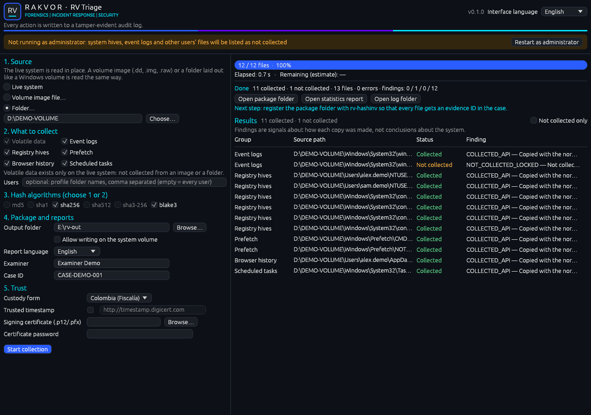
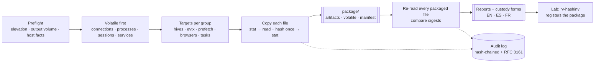
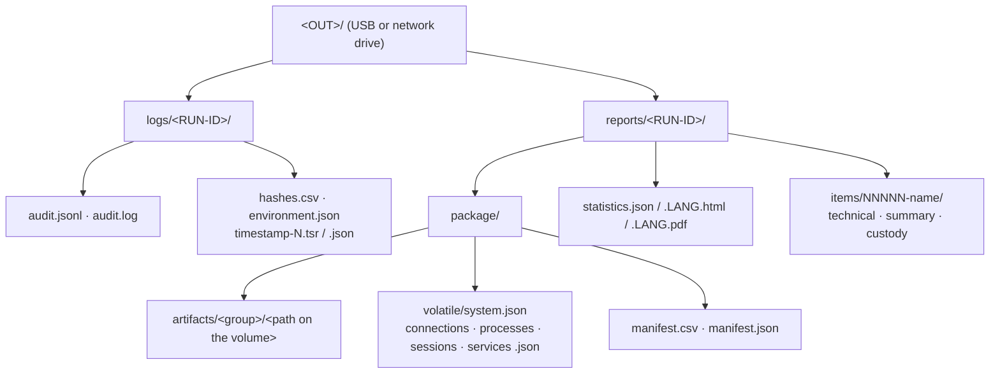

<p align="center"></p>

# RV Triage

<!-- forge:description -->
**Live Windows triage.** Runs from a USB stick and collects volatile data, event logs, registry hives, prefetch, browser history and scheduled tasks into a hashed, logged package that RV HashInv then registers.
<!-- /forge:description -->

[](https://github.com/Panacota96/rv-triage/actions/workflows/ci.yml)






## Contents

- [What you get](#what-you-get)
- [Install](#install)
- [Quick start](#quick-start)
- [Outputs](#outputs)
- [Documentation](#documentation)
- [Project layout](#project-layout)
- [Contributing, security, licence](#contributing-security-licence)
- [Licence](#licence)

## What you get

| | |
| --- | --- |
| **Two ways to use it** | `rv-triage collect` (command line) and `rv-triage-gui` (Windows 10/11 collection screen). Same engine, same package. |
| **Order of volatility** | Volatile data is captured first (network connections, processes with the SHA-256 of their executable, logon sessions, services), then files. |
| **Artifact groups** | `volatile`, `hives` (system hives and `NTUSER.DAT` / `UsrClass.dat`, each with its `.LOG1`/`.LOG2`), `evtx`, `prefetch`, `browsers` (Edge, Chrome, Firefox with `-wal` / `-journal`), `tasks`. Select with `--groups`, limit profiles with `--users`. |
| **Locked files** | Run as administrator: files are read from the raw NTFS volume (`\\.\C:`, read-only), so locked hives and event logs are collected. Not elevated: the normal file API; every file that could not be read is listed with the reason. |
| **One read, then a re-read** | Each file is hashed (1 or 2 of md5, sha1, sha256, sha512, sha3-256, blake3) while it is copied, stat'ed before and after, and the packaged copy is read back and compared. |
| **Sources** | `live` (default), a raw NTFS volume image (`.dd`, `.img`, `.raw`, or an MBR disk image), or a folder laid out like a Windows volume root (rehearsal, mounted image). |
| **Protects the machine** | `--out` is mandatory and is refused on the system volume of the machine being collected unless `--allow-same-volume` (then a high finding). Nothing is ever opened for writing on the source. |
| **Auditable** | Every step goes to `logs/<RUN-ID>/audit.jsonl`, each entry chained to the previous one, with an RFC 3161 timestamp when online. `verify-log` checks the chain **and re-hashes every packaged file**. |
| **Reports** | Statistics report per run; for each packaged file (and each file not collected) a technical review, a customer summary and a chain-of-custody form (Colombia or France, plus English) — HTML, PDF, JSON, in English, Spanish or French. |
| **Hand-off** | The package folder is registered in the lab by **rv-hashinv** (case folder, evidence ids). RV Triage itself takes no case folder in v0.1 ([docs/case-folder.md](docs/case-folder.md)). |

## Install

**Windows 10/11** — download from the [Releases](https://github.com/Panacota96/rv-triage/releases) page and use the
**portable zip** on the USB stick (nothing is installed on the machine being collected):

- `rv-triage-<version>-windows-x64.zip` — portable: `rv-triage.exe`, `rv-triage-gui.exe`, docs, sample.
- `rv-triage-<version>-windows-x64-setup.exe` — per-user installer, for the examiner's own workstation (rehearsals, verification).

Check the download before use and prepare the stick as described in [docs/installation.md](docs/installation.md).

**From source** (any OS for the build and the tests, Rust 1.88+; live collection needs Windows):

```bash
cargo build --release --locked -p rv-triage-cli -p rv-triage-gui
# binaries: target/release/rv-triage and target/release/rv-triage-gui
```

## Quick start

```powershell
# On the examiner's workstation first: the hash implementations against published test vectors
rv-triage self-test

# Rehearsal on the synthetic sample (a folder laid out like C:\): no admin rights needed
rv-triage collect --source examples\sample\source --out $env:TEMP\rv-rehearsal --no-timestamp

# On the machine: open an ADMINISTRATOR terminal, run from the USB stick E:, write to the USB stick
E:\rv-triage\rv-triage.exe collect --out E:\triage --case CASE-2026-014 --actor "Ana Ruiz"

# Only event logs and hives of one user, SHA-256 + MD5, Spanish reports
E:\rv-triage\rv-triage.exe collect -o E:\triage --groups evtx,hives --users ana.ruiz --hash sha256,md5 --lang es

# Afterwards (any machine): the audit chain, its timestamp and every packaged file
rv-triage verify-log E:\triage\logs\<RUN-ID>

# In the lab: register the package in the case folder with rv-hashinv
rv-hashinv scan -i E:\triage\reports\<RUN-ID>\package -r --case-dir F:\CASE-014
```

The command prints a summary ending with the `rv-hashinv` command line for this package. Every option, example and
exit code: [docs/usage-cli.md](docs/usage-cli.md) (generated from `--help`). The desktop app:
[docs/usage-gui.md](docs/usage-gui.md). A ready-made source: [examples/](examples/README.md).

## Outputs



| Path | Content |
| --- | --- |
| `package/artifacts/<group>/<volume path>` | Each copied file at its path on the volume, e.g. `artifacts/hives/Windows/System32/config/SAM` |
| `package/volatile/system.json` | Collection host (name, OS build, boot time, time zone, clock, account, elevation), source description, options. Always written. |
| `package/volatile/{connections,processes,sessions,services}.json` | Volatile lists (live source with the `volatile` group) |
| `package/manifest.csv` | `package_path,group,source,method,bytes,<algo1>[,<algo2>],truncated_at,findings` |
| `package/manifest.json` | `rakvor.triage-manifest/1`: the same plus before/after metadata, and every target **not** collected with its reason |
| `logs/<RUN-ID>/hashes.csv` | Hash register of the packaged files, from the re-read |

| Exit code | Meaning |
| :-: | --- |
| 0 | Completed, no high-severity finding (files not collected are low or medium findings) |
| 1 | Runtime error: source not found or not readable, output not writable, output on the system volume without `--allow-same-volume` |
| 2 | Usage error: `--out` missing, unknown group, more than two hash algorithms, unknown language |
| 3 | Completed with a high finding (`PARTIAL_READ`, `COPY_REREAD_MISMATCH`, `OUTPUT_ON_SYSTEM_VOLUME`); for `verify-log` / `verify-case`: a problem found |
| 130 | Cancelled with Ctrl+C (partial package and reports written, cancellation logged) |

## Documentation

| Page | For |
| --- | --- |
| [docs/usage.md](docs/usage.md) | End-to-end walkthrough: preparing the stick, collecting, reading every output, verifying, handing the package to rv-hashinv, troubleshooting |
| [docs/installation.md](docs/installation.md) | Verifying a release, preparing removable media, elevation, SmartScreen and signature checks, building from source |
| [docs/theory.md](docs/theory.md) | Why each step works: plain language (order of volatility, raw reads, re-reads, the tool's own traces) and the NTFS details for experts |
| [docs/admissibility.md](docs/admissibility.md) | Draft for counsel: Colombia, France/EU, ISO/IEC, RFC 3227 and US/UK requirements mapped to the tool, gaps, checklist |
| [docs/usage-cli.md](docs/usage-cli.md) | Every command and option (generated from `--help`) |
| [docs/usage-gui.md](docs/usage-gui.md) | The collection screen |
| [docs/architecture.md](docs/architecture.md) | Modules, run sequence, sources, states, cancellation |
| [docs/forensic-audit.md](docs/forensic-audit.md) | Audit trail, every action recorded, evidence handling, ISO/IEC 27037 mapping |
| [docs/reports.md](docs/reports.md) | Report kinds, the findings catalogue, limitations, schemas |
| [docs/case-folder.md](docs/case-folder.md) | From package to case folder: verify the package, register it with rv-hashinv |
| [docs/development.md](docs/development.md) | Building, testing, fixtures, regenerating the sample, CI/CD and releasing |
| [docs/release-process.md](docs/release-process.md) | Windows packages, code signing and GitHub releases, step by step |
| [docs/adr/](docs/adr/0001-language.md) | Architecture decisions (why Rust) |

## Project layout

```text
rv-triage/
├── src/
│   ├── core/      engine library (never prints)
│   │   └── src/collect/   sources (live, image, folder), raw NTFS reader, targets, copy, volatile, phase
│   ├── cli/       rv-triage command line (clap)
│   └── gui/       rv-triage-gui collection screen (egui); state.rs holds all testable rules
├── templates/     HTML report templates + CSS (Jinja2/minijinja compatible)
├── i18n/          report and UI wording: en.json, es.json, fr.json
├── schemas/       JSON Schemas of the report kinds and describe --json
├── docs/          documentation (Mermaid diagrams render on GitHub)
├── tests/         cross-language checks (Python verifier of the audit chain and outputs)
├── examples/      synthetic Windows-like source + run scripts + expected hashes and findings
├── packaging/     Windows installer (Inno Setup), code-signing root
└── .github/       CI and release workflows
```

## Contributing, security, licence

- How to contribute: [CONTRIBUTING.md](CONTRIBUTING.md) · Changes: [CHANGELOG.md](CHANGELOG.md)
- Report a vulnerability privately: [SECURITY.md](SECURITY.md)
- Licence: see [Licence](#licence). Third-party notices: [NOTICE](NOTICE).

## Licence

Source-available, non-commercial: [PolyForm Noncommercial 1.0.0](LICENSE). Anyone may use, study, change and share
RV Triage for non-commercial purposes. Credit is required in every use: "RV Triage by Rakvor", and keep the
`Required Notice:` line of [LICENSE](LICENSE). Commercial use (selling it, paid services, use in a for-profit
business's paid work) needs a written licence from Rakvor: see [COMMERCIAL.md](COMMERCIAL.md). Rakvor keeps all
commercial rights as the copyright owner. Rakvor's licensing texts ([COMMERCIAL.md](COMMERCIAL.md),
[NOTICE](NOTICE), this section) are drafts, to be verified by counsel (Colombia, France), and are not legal advice.
Third-party components keep their own licences: [NOTICE](NOTICE).
