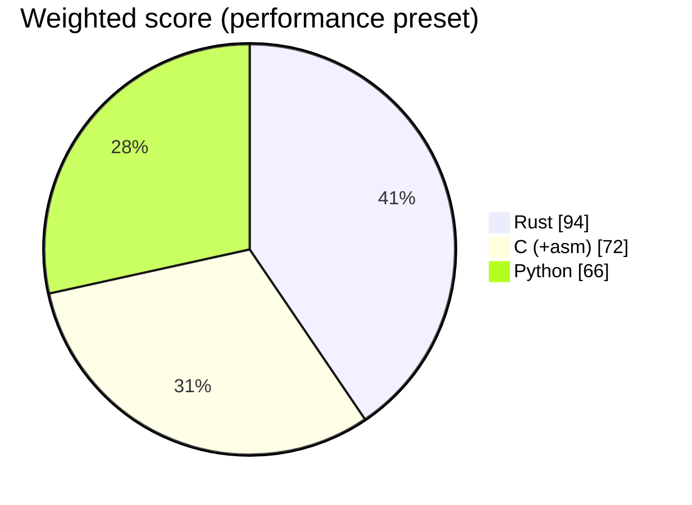

# ADR 0001 — Implementation language: Rust (Profile A)

- Status: accepted
- Date: 2026-11-11
- Deciders: the project owner, without a per-tool advocate council (see Context)

## Context

First-response collection on a live, possibly compromised Windows machine, run from removable media (rv-hub#8). The owner chose Rust for the five planned tools without a per-tool advocate council (2026-11-11), for consistency with the six released Rust tools; the overrides below are the known domain risks, written by the session, not by advocates.

Weight preset: **performance**. Score overrides (domain risks noted by the session, not argued by advocates):

- Python · Packaging, signing, antivirus false positives: 2 → 1 (a Python runtime on a suspect machine writes more to it and is a larger AV target)
- C (+asm) · Memory safety / court auditability: 2 → 1 (raw Win32 code running with admin rights on evidence machines)

## Options scored (1–5, weighted)

| Criterion | Weight | Rust | Python | C (+asm) |
| --- | :-: | :-: | :-: | :-: |
| Speed (throughput, startup) | 4 | 5 | 3 | 5 |
| Transferability (Win10/11 x64 + ARM64, Linux) | 2 | 5 | 4 | 3 |
| Storage (executable / installer size) | 1 | 4 | 2 | 5 |
| Hardware / RAM (8 GB laptops, VMs without GPU) | 4 | 5 | 3 | 5 |
| Windows GUI maturity | 1 | 4 | 4 | 2 |
| CLI --help quality | 1 | 5 | 5 | 2 |
| Packaging, signing, antivirus false positives | 1 | 4 | 1 | 4 |
| Memory safety / court auditability | 3 | 5 | 3 | 1 |
| Team velocity | 1 | 3 | 5 | 3 |
| DFIR library ecosystem | 1 | 4 | 5 | 4 |
| CI/CD complexity (5 = simple) | 1 | 5 | 3 | 3 |
| **Weighted total** (max 100) | | **94** | 66 | 72 |

## Decision

Profile A (Rust workspace: core + clap CLI + egui GUI). 

## Consequences

- Two static executables (CLI + GUI), no runtime to install; one core library powers both.
- Contributors need Rust; Windows binaries are built on GitHub's `windows-latest` runners.
- No hand-written assembly: hash and parsing crates already use SIMD/CPU intrinsics.
