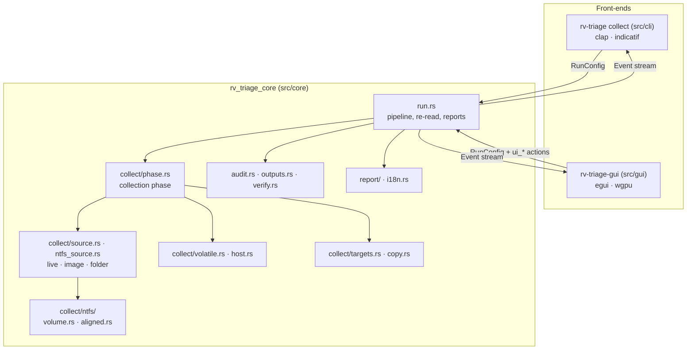
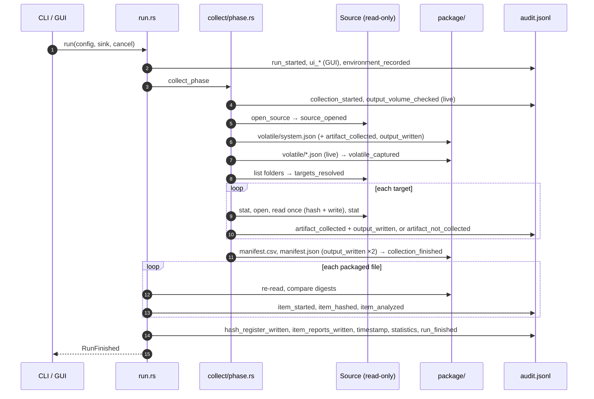
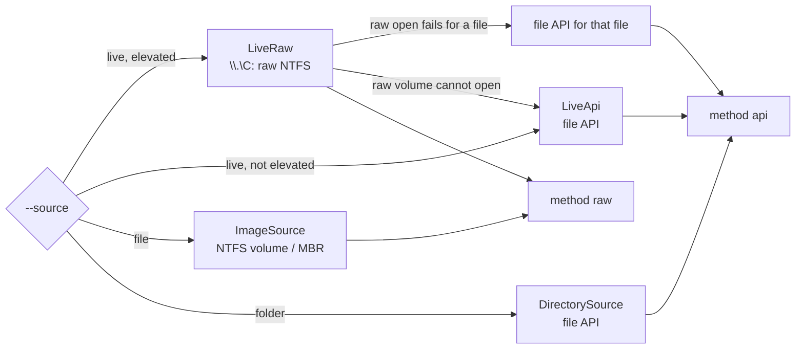
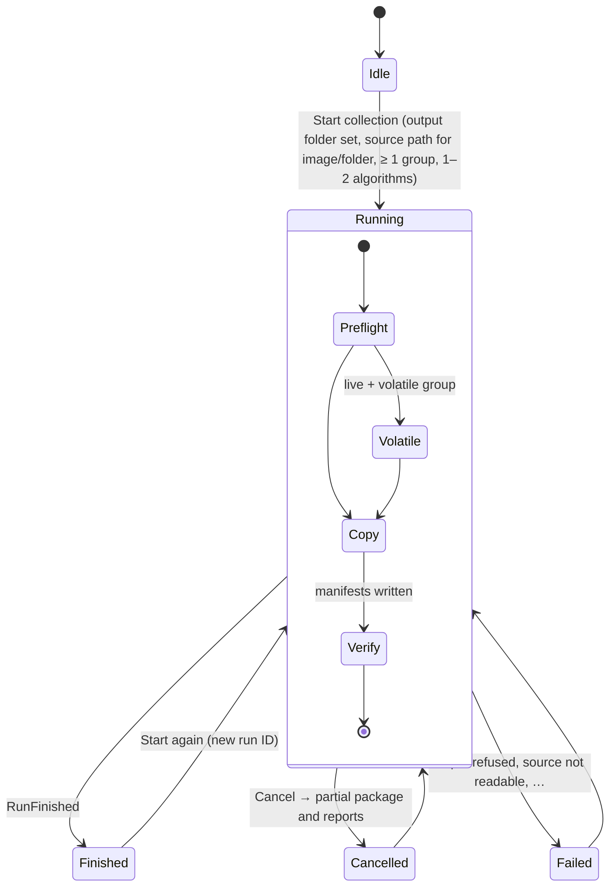

# Architecture

One engine, two front-ends. The engine (`src/core`) does all the work and never prints; the CLI and the GUI only
turn user input into a `RunConfig` (with `RunConfig::collect = Some(CollectOptions)`) and render the `Event`s the
engine emits. Both interfaces therefore produce the same package, logs and reports.

## Modules

| Module | Responsibility |
| --- | --- |
| `collect/mod.rs` | Frozen data model: `Group`, `SourceSpec`, `CollectOptions`, `ReadMethod` (`raw`/`api`/`snapshot`), `FileMeta`, `Collected`, `NotCollected`; the finding `codes`; `not_collected_finding` (locked / no admin / error classification); `display_path` |
| `collect/phase.rs` | The collection phase: preflight, output-volume check, `system.json`, volatile capture, target resolution, copies, manifests; every step in the audit log |
| `collect/source.rs` | The `Source` trait (read-only: `list`, `stat`, `open`, `describe`) and `DirectorySource` (a folder laid out like a volume root; symlinks never followed) |
| `collect/ntfs_source.rs` | `open_image` (NTFS volume image, or the first NTFS partition of an MBR disk image; GPT refused) and `open_live`: elevated = raw `\\.\C:` with a per-file API fallback (`LiveRaw`), not elevated = file API (`LiveApi`) |
| `collect/ntfs/volume.rs` | NTFS parsing through the `ntfs` crate: case-insensitive lookup via `$UpCase`, no reparse-point traversal, `$SI` and `$FILE_NAME` times, valid data length, sparse runs, refusal of compressed / encrypted / reparse data, MFT record reuse check |
| `collect/ntfs/aligned.rs` | `AlignedReader`: serves any byte range while reading the device only in whole sectors (64 KiB blocks); `OffsetReader`: a window onto one partition |
| `collect/targets.rs` | What each group collects, resolved against a source (sorted, de-duplicated; unlistable folders reported) |
| `collect/copy.rs` | One target: stat → stream + hash in one read (tee into the package) → flush + `sync_all` → stat again; `PARTIAL_READ`, `CHANGED_DURING_COPY`; snapshot files |
| `collect/volatile.rs` | Read-only Win32 enumeration: connections, processes (+ executable SHA-256), sessions, services; `VOLATILE_PARTIAL` details |
| `collect/host.rs` | Host facts for `system.json`, elevation (token), `same_volume` (`GetVolumePathNameW` + volume GUID) |
| `run.rs` | Orchestration: audit log, environment, the collection phase, **re-read** of every packaged file (`COPY_REREAD_MISMATCH`), `hashes.csv`, item and statistics reports, RFC 3161 timestamp, cancellation |
| `hash.rs` | One read loop (1 MiB chunks) feeding 1–2 digests; known-answer self-test |
| `audit.rs`, `verify.rs`, `outputs.rs` | Hash-chained `audit.jsonl`; `verify-log` (chain, timestamps, truncation, re-hash of every recorded output incl. package files) |
| `trust.rs` | RFC 3161 client and token verification; CMS signing of PDFs |
| `report/` | View models → minijinja HTML, built-in PDF writer, schema-versioned JSON; `LIMITATIONS` |
| `case.rs` | The shared case folder (`verify-case`); not used by `collect` in v0.1 ([case-folder.md](case-folder.md)) |
| `analyzer.rs`, `input.rs` | Reference file pipeline kept from the template (signature detection, input lists); `collect` does not call them |

## One run, step by step

The same order is in the code comment at the top of [collect/mod.rs](../src/core/src/collect/mod.rs) and in the
audit-action table of [forensic-audit.md](forensic-audit.md#actions-recorded).

### Sources and read methods

| Source | `kind` | Method | Locked files | `$FILE_NAME` times, MFT record | Volatile |
| --- | --- | --- | --- | --- | --- |
| live, elevated | `live` | `raw` (per-file `api` fallback when the raw read of that file fails, e.g. NTFS-compressed) | readable | yes (raw) | yes |
| live, not elevated | `live` | `api` | `NOT_COLLECTED_NO_ADMIN` | no | yes |
| volume or MBR disk image | `image` | `raw` | — | yes | `NOT_AVAILABLE_FROM_SOURCE` |
| folder | `directory` | `api` | — | no | `NOT_AVAILABLE_FROM_SOURCE` |

`SourceSpec::parse` treats `live` (any case) as the live system, an existing folder as a directory source and
anything else as an image; the CLI refuses a path that does not exist before anything is written.

## Run states (as the GUI sees them)

The inner steps follow the `Phase` events (`preflight`, `volatile`, `copy`) and `RunStarted` (re-read and
reports); the GUI shows them as *Step* text.

## Concurrency and cancellation

- The GUI runs the engine on a worker thread and receives events through a channel, so the window stays
  responsive.
- Everything is sequential on purpose: one source file at a time, in the sorted target order, so the order of the
  audit entries is the order of work. The NTFS parser sits behind a mutex; each read re-resolves the file record
  and checks its sequence number.
- Cancellation is an `AtomicBool`, checked between volatile lists, between files and after every chunk of a copy.
  A copy cancelled half-way is deleted from the package. The engine then writes the manifests,
  `collection_finished` (`cancelled: true`), `run_cancelled`, `hashes.csv` and partial reports. Note: the re-read
  loop sees the same flag and stops at once, so after a cancel during the copy the packaged files are listed in
  the manifests and the audit log (`artifact_collected` with digests) but get no item report and no `hashes.csv`
  row.
- A panic inside the NTFS parser (inconsistent metadata on a live volume) is caught and becomes a read error for
  that file, not an aborted collection.

## Why Rust

See [ADR 0001](adr/0001-language.md).
