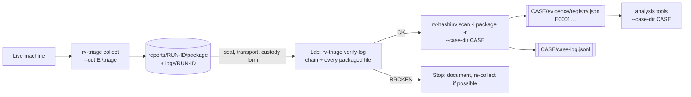

# From package to case folder

Rakvor tools share **one case folder** per engagement (`--case-dir`): the intake tool registers each evidence file
once with an evidence id (`E0001`, `E0002`, …) and later analysis tools verify against that registry.

**RV Triage takes no case folder in v0.1.** It runs on the machine being collected, where the case folder must not
be (and usually is not) available; it writes a self-contained, audit-logged **package** instead. The package is
registered in the lab by **rv-hashinv**, the intake tool. `describe --json` reports the role `collection` for this
reason.



## 1. Verify the package before intake

The collection's own audit log vouches for the package: every packaged file and both manifests are recorded with
their digests (`output_written`), and `verify-log` re-hashes them.

```powershell
# the whole output folder was copied: F:\incoming\triage\{logs,reports}\<RUN-ID>
rv-triage verify-log F:\incoming\triage\logs\<RUN-ID>
# OK  152 entries, chain intact: …\audit.jsonl
#     truncation not detectable without a timestamp or case record
#     outputs: 294 verified of 294 recorded (md5, sha256)
```

| `verify-log` checks | Detects |
| --- | --- |
| The hash chain of `audit.jsonl` | an edited, deleted or re-ordered entry |
| Each RFC 3161 token (`timestamp_obtained`) | a log shorter than its timestamp, a token that does not match the head, an invalid TSA signature (`--tsa-ca` for the chain) |
| Every recorded output: `package/artifacts/…`, `package/volatile/*.json`, `package/manifest.csv`, `package/manifest.json`, the reports, `hashes.csv`, `environment.json` | a packaged file edited, deleted or replaced since the collection (exit 3, the file and both digests named) |

Requirements and limits:

- Keep `logs/<RUN-ID>` and `reports/<RUN-ID>` as siblings under one folder: the re-hash resolves `package/…` inside
  `reports/<RUN-ID>`. A package copied on its own cannot be checked against the log.
- A file **added** to the package after the collection is not in the log and is not reported by `verify-log`;
  compare the package with `manifest.csv` (one row per packaged file) before intake.
- Without a timestamp, the end of the log is not anchored (`truncation not detectable …`): compare the audit head
  with the one written in the collection notes, and stamp the log with `rv-triage timestamp`.
- Independent check: `python tests/verify_chain.py <log folder>` (Python re-implementation).

## 2. Register the package with rv-hashinv

```powershell
# first intake into a new case (creates case.json; --case and --jurisdiction only now)
rv-hashinv scan -i F:\incoming\triage\reports\<RUN-ID>\package -r --case-dir F:\CASE-014 --case CASE-014
# later packages into the same case
rv-hashinv scan -i F:\incoming\triage2\reports\<RUN-ID>\package -r --case-dir F:\CASE-014
```

rv-hashinv hashes every file of the package again, gives each one an evidence id in
`<CASE>/evidence/registry.json` and writes its own run under `<CASE>/runs/rv-hashinv/<RUN-ID>/`. From rv-hashinv
0.5 on, the intake recognises the package (`manifest.json`, format `rakvor.triage-manifest/1`, which names this
tool, its version and the collection's run id), verifies this collection's audit log like `verify-log` does, and
records the collection's **final audit entry and head** in a `collection_linked` entry of its own audit log. Every
registered file is compared with the digest recorded here: a difference is `COLLECTION_DIGEST_MISMATCH` (high), a
missing or broken collection log `COLLECTION_LOG_UNVERIFIED` (medium). Give rv-hashinv the package **inside the
whole output folder** (`<OUT>/reports/<RUN-ID>/package`, with `<OUT>/logs/<RUN-ID>` next to it), or the link cannot
be made. With an older rv-hashinv, compare its digests with `manifest.csv` by hand. The case-folder layout, events
and `verify-case` are documented in rv-hashinv's `docs/case-folder.md`.

Keep the collection's `logs/<RUN-ID>` and `reports/<RUN-ID>` (statistics, item reports, custody forms) with the
case file: they show how the package was made, which rv-hashinv cannot.

## 3. `verify-case` in this tool

`rv-triage verify-case <CASE>` is the shared verifier of every Rakvor tool and works on any case folder (case log,
registry, every run's audit log and outputs, `--rehash`). RV Triage's own runs never appear in a case folder in v0.1.

## Safety rules

| Rule | Why |
| --- | --- |
| Never write the package into the case folder from the live machine | the case folder belongs to the lab; the machine is untrusted |
| Verify before intake | rv-hashinv's registry fixes the digests from intake on; a package damaged in transport would be registered as is |
| Register the package folder, not single files | the manifest and `system.json` give context to every artifact |
| One collection, one package, one intake run | the item numbers, audit ranges and custody forms stay one-to-one |
