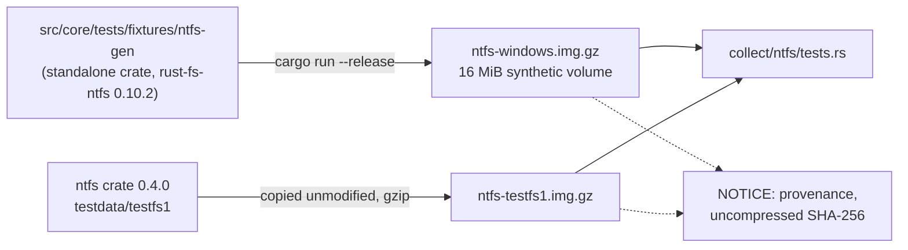
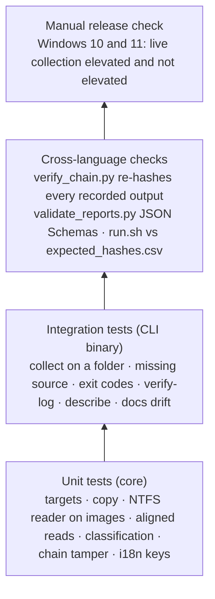
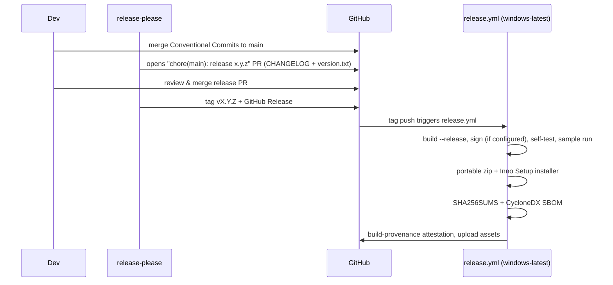

# Development, CI/CD and releases

## Build and test locally

```bash
cargo build --workspace                 # debug build of core, CLI and GUI
cargo test  --workspace                 # unit + integration tests (GUI tests are headless)
cargo clippy --workspace --all-targets -- -D warnings
cargo fmt --all -- --check
cargo run -p rv-triage-cli -- collect --source examples/sample/source --out /tmp/rv-out --no-timestamp
cargo run -p rv-triage-gui
cargo run -p rv-triage-cli -- docs-cli > docs/usage-cli.md      # after any change to --help (a test compares them)
```

Set `RV_TEST_PYTHON` to a Python with `blake3 jsonschema pyhanko` to make the cross-language and trust tests
mandatory (CI does); without it they are skipped. Linux needs no system packages to build. On Windows use the MSVC
toolchain; binaries are linked with the static C runtime (`.cargo/config.toml`). The toolchain is pinned in
[rust-toolchain.toml](../rust-toolchain.toml).

Live collection only works on Windows; everything else (image and folder sources, the NTFS reader, reports,
verification) is built and tested on Linux too. The live-capture test (`live_capture_without_admin`) runs only on Windows, and
`live_source_without_admin_uses_the_file_api` checks the Windows path there and the "needs Windows" error elsewhere. No test needs administrator rights: the raw
NTFS code is tested on volume images, and `raw_device_path_reads_with_aligned_io_only` checks that every device
read is sector-aligned with a reader that rejects anything else.

## Collection modules

| File | Change it when |
| --- | --- |
| [collect/mod.rs](../src/core/src/collect/mod.rs) | adding a group, a finding code (also in `i18n/{en,es,fr}.json`) or a field (data model is **frozen** for v0.1: add, never rename) |
| [collect/targets.rs](../src/core/src/collect/targets.rs) | changing what a group collects (keep the table in the module comment and [theory.md B9–B10](theory.md#b9-registry-hives-and-their-transaction-logs) in sync) |
| [collect/copy.rs](../src/core/src/collect/copy.rs) | the copy, partial reads, change detection |
| [collect/phase.rs](../src/core/src/collect/phase.rs) | order of the phase, audit entries, manifests (update [forensic-audit.md](forensic-audit.md#actions-recorded)) |
| [collect/ntfs_source.rs](../src/core/src/collect/ntfs_source.rs), [ntfs/volume.rs](../src/core/src/collect/ntfs/volume.rs), [ntfs/aligned.rs](../src/core/src/collect/ntfs/aligned.rs) | sources and the NTFS reader |
| [collect/volatile.rs](../src/core/src/collect/volatile.rs), [collect/host.rs](../src/core/src/collect/host.rs) | volatile lists and host facts (Windows `windows_impl` modules) |

Adding a finding: add the constant to `codes`, raise it, add `title`/`shows`/`does_not_prove` to the three
`i18n/*.json` files (a test checks identical keys), and add a row to the catalogue in
[reports.md](reports.md#findings-catalogue).

## Test fixtures



| Fixture | What | Provenance |
| --- | --- | --- |
| `src/core/tests/fixtures/ntfs-windows.img.gz` | 16 MiB NTFS volume (4 KiB clusters, 4 KiB records, serial `RVTRIAGE`) with a Windows-like layout: hives, an empty `.evtx`, 41 prefetch files (forces an `$INDEX_ALLOCATION`), tasks, an Edge `History`, a non-ASCII file name, a **sparse** `NTUSER.DAT`, a fragmented file grown past its **valid data length** over stale `0xEE` clusters, and a **junction** | Generated by `ntfs-gen` (Rakvor; `rust-fs-ntfs` 0.10.2, MIT OR Apache-2.0, no GPL tool); fixed `$STANDARD_INFORMATION` times (2026-01-02T03:04:05Z + 1, 2, 3 days); `$FILE_NAME` times are those of generation |
| `src/core/tests/fixtures/ntfs-testfs1.img.gz` + `ntfs-testfs1.LICENSE-MIT` | the `ntfs` crate's own test volume | `ntfs` 0.4.0 (Colin Finck, MIT OR Apache-2.0), unmodified |

Both are listed in [NOTICE](../NOTICE) with their uncompressed SHA-256. To regenerate the synthetic volume:

```bash
cd src/core/tests/fixtures/ntfs-gen
cargo run --release -- ../ntfs-windows.img.gz      # standalone crate: its own [workspace], never built by CI
gzip -dc ../ntfs-windows.img.gz | sha256sum         # update the SHA-256 in NOTICE
```

The gzip header has mtime 0, but the `$FILE_NAME` times change on every generation, so the image (and its
SHA-256) changes: update NOTICE, and keep tests independent of `fn_*` values (they only check the format). Every
byte of content is a fixed synthetic pattern; never add real data to a fixture.

## The sample source

`examples/sample/source/` is a folder source used by CI, the release workflow and the run scripts.

```bash
python examples/sample/make_source.py     # rewrites source/ (deterministic: byte-identical output)
python examples/sample/make_expected.py   # rewrites expected_hashes.csv and expected_findings.json from source/
examples/sample/run.sh target/debug/rv-triage
```

`make_expected.py` is deliberately independent of the Rust code: it decides each file's group from the documented
target table and hashes with Python's `hashlib`. If a change in `targets.rs` makes the run script fail, decide
which side is wrong before regenerating.

## Test pyramid



## Continuous integration

`ci.yml` runs on every push and pull request (read-only permissions): fmt, clippy, `cargo test --workspace` on
Ubuntu and Windows (with `RV_TEST_PYTHON`), `self-test`, a collection of the sample source, `verify_chain.py` and
`validate_reports.py` on it, `run.sh` (Linux), the cross-profile golden case for `verify-case`, an informative
DigiCert timestamp smoke test (Windows), and a release build of both executables (Windows artifact).

## Releasing



| Artifact | Built by |
| --- | --- |
| `rv-triage-X.Y.Z-windows-x64.zip` | portable (the USB-stick package): both exes + README + LICENSE + COMMERCIAL.md + NOTICE + CHANGELOG + `docs/` + `examples/` |
| `rv-triage-X.Y.Z-windows-x64-setup.exe` | Inno Setup (`packaging/windows/installer.iss`), per-user, for the examiner's workstation |
| `SHA256SUMS` | `sha256sum` over the assets |
| `sbom.cdx.json` | `cargo cyclonedx` |
| Attestation | `actions/attest-build-provenance` |

CHANGELOG.md is written by release-please from the commit messages: do not edit it by hand. Signing, secrets and
manual packaging: [release-process.md](release-process.md).

### Release checklist (manual)

- [ ] `rv-triage self-test` on the released exe passes on Windows 10 **and** Windows 11
- [ ] On a test VM: `collect --out <second disk>` elevated (summary says `raw`, hives and `Security.evtx` collected) and not elevated (`NOT_COLLECTED_NO_ADMIN` rows, run completes); `verify-log` OK on both
- [ ] `--out` on `C:` is refused (exit 1); with `--allow-same-volume` the run ends with exit 3 and `OUTPUT_ON_SYSTEM_VOLUME`
- [ ] GUI: *Restart as administrator* works, the run completes, *Open package folder* works
- [ ] `SHA256SUMS` matches the downloaded files; `gh attestation verify` passes
- [ ] The installer builds (see the `examples\sample\evidence` note in [installation.md](installation.md#5b-installer-per-user-no-administrator))
