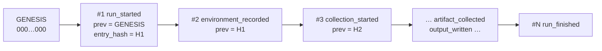
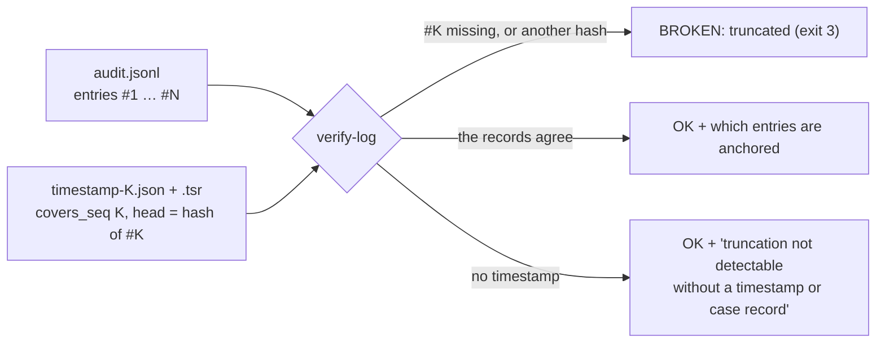
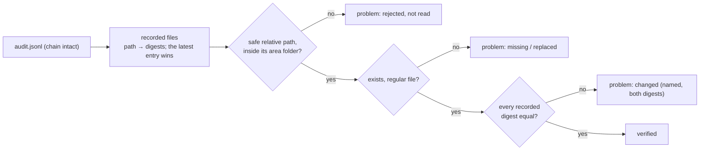
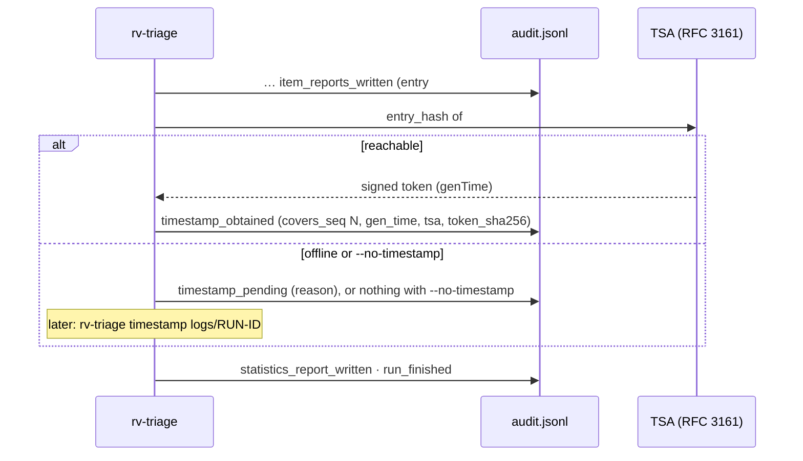
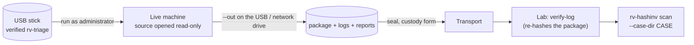

# Forensic audit trail

Everything RV Triage does is written to `<OUT>/logs/<RUN-ID>/`. The folder is designed so that a second examiner,
months later, can check **what was collected from which machine, how each file was read, by whom, with which tool
version**, that the record was not altered, and that the package still holds the bytes that were read.

| File | Content |
| --- | --- |
| `audit.jsonl` | One JSON object per action, hash-chained (authoritative) |
| `audit.log` | The same actions as readable text (convenience copy) |
| `hashes.csv` | Hash register of the packaged files, from the re-read: `index,path,size,<algo1>[,<algo2>],status,error` |
| `environment.json` | Tool version, compiler, target, every dependency version, OS, host, OS user, working folder, command line |
| `timestamp-<N>.tsr` / `.json` | RFC 3161 token over the chain head and its readable summary (when obtained) |

The package itself is in `<OUT>/reports/<RUN-ID>/package/`; every file in it is named in the log with its digests
(`output_written`), so the log vouches for the package.

## The hash chain



Each entry has: `seq`, `ts_utc`, `run_id`, `actor`, `action`, optional `item`, `details`, `prev_entry_hash`,
`entry_hash`.

```text
entry_hash = SHA-256( canonical JSON of the entry without "entry_hash" )
canonical  = keys sorted at every level, no spaces, UTF-8, integers only
             (Python: json.dumps(e, sort_keys=True, separators=(",", ":"), ensure_ascii=False))
```

Editing a value changes that entry's hash; deleting or re-ordering breaks `seq` and `prev_entry_hash`. Verify with
either implementation:

```bash
rv-triage verify-log E:/triage/logs/<RUN-ID>          # exit 0 intact, 3 broken, truncated or an output changed
python tests/verify_chain.py E:/triage/logs/<RUN-ID>   # independent re-implementation (chain + recorded outputs)
```

> The chain proves the log is **internally consistent**. On its own it does not prove *when* it was written —
> that is what the trusted timestamp adds — nor that it is *complete*: removing the last entries leaves a shorter
> chain that is still valid. Keep the final `entry_hash` (printed by the CLI as `audit head` and in the statistics
> report) in your case notes.

### Truncation: what anchors the end of the log

A chain cannot vouch for its own length, so `verify-log` compares the end of the log with the records kept
**outside** it:



A collection run is standalone (`<OUT>/logs/<RUN-ID>`): the RFC 3161 token is its only anchor. The head is stamped
**before** `timestamp_obtained`, `statistics_report_written` and `run_finished` are written, so those 3 entries are
reported as "cannot be proven complete". Without a timestamp `verify-log` prints `truncation not detectable without
a timestamp or case record` (exit 0: nothing contradicts the log, but nothing vouches for its length). Run
`rv-triage timestamp <log folder>` once the network is back.

### Recorded outputs: the files the log vouches for

The chain proves that the *digests* recorded in the log are unchanged, not that the files they describe still have
them. `verify-log` therefore re-hashes every output file the log records and compares it with every digest
recorded for it ([src/core/src/outputs.rs](../src/core/src/outputs.rs), shared byte-identical by every Rakvor tool):



| Entry | File |
| --- | --- |
| `output_written` (`details.file` = `package/…`) | `reports/<RUN-ID>/package/…`: every artifact copy, every `volatile/*.json`, `manifest.csv`, `manifest.json` |
| `environment_recorded`, `hash_register_written` | `logs/<RUN-ID>/environment.json`, `logs/<RUN-ID>/hashes.csv` |
| `item_reports_written` | `reports/<RUN-ID>/items/<folder>/<file>` for every file of the item |
| `statistics_report_written` | `reports/<RUN-ID>/statistics.json` and every `statistics.<LANG>.html/.pdf` |
| `timestamp_obtained` | not re-hashed here: the token is checked by the timestamp verification |

The check works only on the original layout: `logs/<RUN-ID>` and `reports/<RUN-ID>` must be siblings under the same
`<OUT>` folder. **Copy the whole `<OUT>` folder** (or at least both run folders) to the lab, not the package alone.
A recorded path that is absolute, contains `..`, a drive, `\` or `:`, or resolves outside its area folder through a
symlink or junction is rejected and never read. Output: `outputs: N verified of M recorded (algorithms)`. On the
sample source: `outputs: 294 verified of 294 recorded (md5, sha256)`.

## Trusted timestamp (RFC 3161)

Every run asks a Time-Stamp Authority (TSA) to sign the chain head **just before the statistics report** is
written. Default TSA: `http://timestamp.digicert.com` (`--tsa-url` to change). On a live machine this is the only
network traffic the tool generates; use `--no-timestamp` on a machine that must not reach the network, and stamp
the log later from the lab.



- The token is stored next to the log: `timestamp-<N>.tsr` (DER) and `timestamp-<N>.json`.
- The TSA receives the chain head itself (already a SHA-256 digest) as the message imprint; nothing else.
- `verify-log` checks each token: imprint = stored head, entry `#N` still exists with that hash, and the TSA's CMS
  signature. The TSA certificate chain is validated only with `verify-log --tsa-ca <CA bundle>`; revocation is
  never checked (establish it from CRL/OCSP evidence covering genTime).
- **Limitation:** a timestamp proves the log existed at that time, not that its content is true, and not that the
  package matches the machine as it was (`TIMESTAMP_PROVES_EXISTENCE_ONLY`).

## Signed PDF reports

`--sign-cert examiner.p12` (GUI: *5. Trust → Signing certificate*) signs every PDF — statistics, technical, summary
and custody — with **your own** certificate. The password comes from the environment variable named by
`--sign-pass-env` (default `RV_SIGN_PASSWORD`) or an interactive prompt; it is never written to any log. The log
records `signing_certificate_loaded` (subject, SHA-256 fingerprint); a wrong password stops the run (`run_failed`,
exit 1) **before** the collection starts. HTML, JSON and the package are not signed: their digests are in the
audit chain, which is timestamped.

## Chain-of-custody form per item

`--jurisdiction co` (default) writes, for each packaged file and each file not collected, a Colombian *registro de
cadena de custodia* in Spanish; `--jurisdiction fr` a French *fiche de scellé / suivi* in French. An English
version is always added. The form is pre-filled from the run (case, item, size, digests, UTC times, tool,
examiner, audit entries) and leaves signature lines for the physical transfers of the USB stick. This is a working
aid, not legal advice: check it against the current official form.

## Actions recorded

In the order they appear. Actions marked *collect* are written by [collect/phase.rs](../src/core/src/collect/phase.rs);
the others by [run.rs](../src/core/src/run.rs).

| Action | When | `item` | Key `details` |
| --- | --- | --- | --- |
| `run_started` | first | — | tool, version, frontend, algorithms, langs, case_id, out_dir, jurisdiction, tsa_url, sign_cert, `collect` (the options) |
| `ui_*` | GUI only: every setting changed before Start, then `ui_start_clicked` | — | the new value, `at_utc` |
| `environment_recorded` | | `environment.json` | its digests |
| `signing_certificate_loaded` | with `--sign-cert` | certificate path | subject, `certificate_sha256` |
| `collection_started` *collect* | | — | `options` (source kind and path, groups, users, allow_same_volume), `elevated`, `system_drive` |
| `output_volume_checked` *collect* | live source only | the `--out` folder | `system_drive`, `same_volume`, `allowed` |
| `run_failed` | output on the system volume refused, source cannot be opened, wrong certificate password | — | `reason` |
| `source_opened` *collect* | | — | the source description: `kind`, `method`; live raw: `volume`, `device`, `fallback`; image: `path`, `layout` (`volume`/`mbr`), `partition_offset`; raw: `bytes_per_sector`, `cluster_size`, `file_record_size`, `volume_serial`, `volume_serial_64`, `total_size`, `ntfs_version`, `volume_label`; live API after a failed raw open: `raw_error`; folder: `root` |
| `artifact_collected` *collect* | `volatile/system.json`, each volatile file, each copied file | source display path (`C:\Windows\…`) | `group`, `source` (volume path), `package`, `method`, `bytes`, `hashes`, `before` / `after` (`FileMeta`: size, `mft_record`, `si_*` and `fn_*` times, sparse/compressed/encrypted), `truncated_at`, `read_error`, `findings` |
| `output_written` *collect* | right after each `artifact_collected`; then once per manifest | package path | `file` (`package/<rel>`), `kind` (`package_<group>` or `manifest`), `bytes`, `hashes` |
| `volatile_captured` *collect* | live source with the `volatile` group | — | `available`, `started_utc`, `finished_utc`, counts of `processes`, `connections`, `sessions`, `services`, `partial` (what, incomplete, of, reason) |
| `artifact_not_collected` *collect* | each target not in the package (volatile from an image/folder, an unlistable folder, a file that could not be read or written) | source display path | `group`, `source`, `reason`, `finding` |
| `targets_resolved` *collect* | after the folders are listed | — | `files`, `per_group`, `unlisted` (folders that could not be listed) |
| `collection_finished` *collect* | after both manifests | — | `collected`, `not_collected`, `bytes` (bytes copied from the source, snapshot files excluded), `cancelled` |
| `inputs_resolved` | | — | `items` (packaged files to re-read), `bytes` |
| `item_started` / `item_hashed` / `item_analyzed` | each packaged file, during the re-read | package path | index, size, source `modified_utc`; re-read digests, `bytes_read`; findings, status |
| `item_error` | a packaged file that cannot be re-read (`UNREADABLE`) | package path | message |
| `item_cancelled` / `run_cancelled` | on cancel | | processed count |
| `hash_register_written` | | `hashes.csv` | its digests |
| `item_reports_written` | each item (packaged or not collected) | path | digests of every report file |
| `timestamp_obtained` / `timestamp_pending` | with a TSA | token file | covers_seq, gen_time, tsa / reason |
| `statistics_report_written` | | — | digests of the statistics files |
| `run_finished` | last | — | items, bytes, errors, elapsed, counts per severity, cancelled |

## Evidence handling



- Sources are opened read-only: the raw volume with `File::open` on `\\.\C:` (read access, other processes keep
  sharing), files with `File::open`; no source implementation opens anything for writing or changes a timestamp
  ([source.rs](../src/core/src/collect/source.rs)). The volatile capture writes nothing to the machine: no files, no
  registry, no ETW or WMI sessions, no services ([volatile.rs](../src/core/src/collect/volatile.rs)).
- Links are never followed: symlinks in a folder source, reparse points (junctions, symbolic links) on NTFS.
- Each file is stat'ed before and after the copy; a change is a `CHANGED_DURING_COPY` finding, not a silent
  difference. The package copy is flushed with `sync_all` and read back.
- What the tool cannot avoid — its own process, prefetch and Amcache entries, USB device records, the event-log
  records of the logon — is listed in [theory.md A5](theory.md#a5-the-tools-own-traces) and in the
  `EXECUTION_LEAVES_TRACES` limitation of every report. Note the start time of the run (`run_started.ts_utc`).

## Mapping to ISO/IEC 27037:2012

Clause titles verified from the standard's table of contents; clause contents are summarised from secondary
sources (see [admissibility.md §6.1](admissibility.md#61-isoiec-270372012--identification-collection-acquisition-and-preservation-of-digital-evidence)).

| 27037 principle / activity | How RV Triage supports it |
| --- | --- |
| Auditability (5.3.2) | Every action logged with actor, UTC time and chain hash; `verify-log` checks the chain, its end against the timestamp, and re-hashes every packaged file and report |
| Repeatability (5.3.3) | `environment.json` records the exact tool and dependency versions; on a static source (image, folder) the same options give the same package digests (the sample's `expected_hashes.csv`) |
| Reproducibility (5.3.4) | Independent verifier (`tests/verify_chain.py`); the sample digests are computed independently with Python (`make_expected.py`); standard algorithms. A **live** collection cannot be reproduced: the machine changes — hence the before/after stat, the order of volatility and the timestamp |
| Justifiability (5.3.5) | Every finding states what it shows and what it does **not** prove; 6 limitations in every report; method per file (`raw`/`api`/`snapshot`) in the manifest |
| Live acquisition / volatile data (acquisition clauses, see admissibility §8) | Volatile first; the tool's footprint documented; `system.json` records host clock, time zone, boot time and elevation |
| Preservation | Read-only sources; digests taken during the copy and on the re-read; package and reports hashed in the log |
| Documentation / chain of custody | Manifest, hash register, reports, custody forms and the log folder form the record of the collection |
