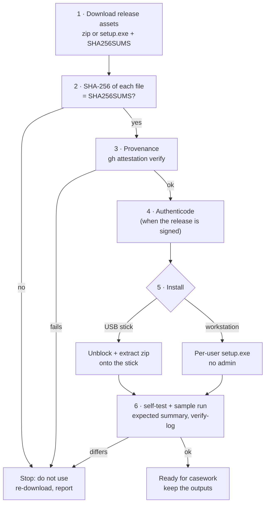

<!--
  Template note for the docs agent of a tool scaffolded from rv-triage: steps 1–5 and 7–11 are shared (release
  assets, verification, installer, offline use, build from source, uninstall). Rewrite the parts between
  forge:domain markers: native libraries the tool needs, and the expected result of the sample run.
-->

# Installation and verification (Windows 10/11)

RV Triage has two places of use: the **examiner's workstation** (verification, rehearsals, `verify-log` in the lab)
and the **machine being collected**, where it runs from a USB stick and installs nothing. It needs no runtime
(static C runtime) and no network, except for the optional RFC 3161 timestamp and the optional release check. On the machine it should run **as
administrator** (raw NTFS reads of locked files). This page covers: getting a release, **proving it is the genuine
build**, preparing the USB stick, elevation, SmartScreen and signature checks on a machine you do not control, the
first-run self-test, offline use, building from source for auditors, where files live, and uninstalling.

Why verification matters: a court may ask how you know the program you ran is the one whose source an expert
reviewed. Steps 2–4 and 6 produce that answer; keep their output with the case file
([admissibility.md](admissibility.md#examiner-checklist-before-filing-a-report), step 3).



## Requirements

| Item | Requirement |
| --- | --- |
| Operating system | Windows 10 or 11, x64 (`MinVersion=10.0`, `ArchitecturesAllowed=x64compatible` in the installer). Linux/macOS: build from source. |
| Rights | Workstation: standard user (the installer is per-user, `PrivilegesRequired=lowest`). Machine being collected: **administrator** for a full collection (raw read of `\\.\C:`); without it the run continues on the file API and lists what it could not read. Image and folder sources need no rights. |
| Removable media | A USB stick or drive formatted NTFS or exFAT (FAT32 refuses files over 4 GiB) with room for the package: typically a few hundred MB to a few GB, plus about 11 report files per item for one language (19 with `--lang all`). |
| Memory | Files are streamed in 1 MiB chunks: memory use does not grow with file size. |
| Graphics | None required: the GUI also runs on VMs without a GPU driver (software rendering). |
| Network | None, except the optional timestamp request (see [step 7](#7-offline-and-air-gapped-use)). |
| Release check | Optional, notify only: the desktop app at start-up and `rv-triage update-check` read the public latest-release page on github.com ([Release check](#release-check)); `RV_NO_UPDATE_CHECK=1` turns it off. |
| Live collection | Windows only. On Linux/macOS the CLI builds and collects from images and folders. |

## 1. Download

Release assets on the GitHub Releases page of the repository (`Panacota96/rv-triage`):

| Asset | What it is |
| --- | --- |
| `rv-triage-X.Y.Z-windows-x64.zip` | Portable: `rv-triage.exe`, `rv-triage-gui.exe`, README, LICENSE, COMMERCIAL.md, NOTICE, CHANGELOG, `docs/`, `examples/` |
| `rv-triage-X.Y.Z-windows-x64-setup.exe` | Inno Setup installer, per-user |
| `SHA256SUMS` | SHA-256 of the zip, the installer and the SBOM (`sha256sum` format: `<hash>  ./<file>`) |
| `sbom.cdx.json` | CycloneDX software bill of materials (every Rust dependency and version) |

Put them in one folder, e.g. `C:\Rakvor\downloads\rv-triage-0.1.0\`.

## 2. Verify the download

```powershell
cd C:\Rakvor\downloads\rv-triage-0.1.0
Get-Content .\SHA256SUMS | ForEach-Object {
    $hash, $name = $_ -split '\s+', 2
    $name = $name.TrimStart('*').Replace('./', '')
    if (Test-Path $name) {
        $actual = (Get-FileHash -Algorithm SHA256 $name).Hash.ToLower()
        if ($actual -eq $hash) { "OK    $name" } else { "FAIL  $name  (got $actual)" }
    } else { "skip  $name (not downloaded)" }
}
```

```bash
sha256sum -c --ignore-missing SHA256SUMS      # Linux, or Git Bash on Windows
```

Every downloaded file must print `OK`. `SHA256SUMS` is produced by the same workflow and is not attested itself:
step 3 is the stronger check.

## 3. Verify build provenance

Each zip and installer carries a GitHub build-provenance attestation (`actions/attest-build-provenance`): a signed
statement that this exact file was built by the repository's release workflow from a given commit. On a machine
with internet access and the GitHub CLI:

```powershell
gh attestation verify .\rv-triage-0.1.0-windows-x64.zip --repo Panacota96/rv-triage
gh attestation verify .\rv-triage-0.1.0-windows-x64-setup.exe --repo Panacota96/rv-triage
```

The output names the workflow (`.github/workflows/release.yml`) and the source commit; record both. For an
air-gapped lab, verify on a connected machine and carry the verified files on write-protected media (the GitHub CLI
can also download the attestation bundle and trusted root for offline checks; see `gh attestation verify --help`).
`SHA256SUMS` and the SBOM are not attested.

## 4. Verify the Authenticode signature (signed releases)

The release workflow signs `rv-triage.exe`, `rv-triage-gui.exe` and the installer **only when a code-signing
certificate is configured** for the repository. Releases are signed with Rakvor's **internal** code-signing
certificate ("Rakvor Code Signing (internal)", issued by "Rakvor Internal Code Signing Root CA"). It is not a public
certificate: Windows trusts it only on machines where the Rakvor root is installed — Rakvor's own laptops, since the
tool is used locally and not distributed. Auditors and customers verify releases with steps 2–3 and can inspect the
signature with the root's fingerprint below.

Install the root once per Rakvor machine (PowerShell as the user who runs the tool; the file is
`packaging/signing/rakvor-code-signing-root.cer` in the repository):

```powershell
# Check the fingerprint first — it must be exactly:
#   SHA-256 DC9BA1A2FCD4F0633C5214B7CCEB25BED8F3F7D9EBAF111590250CBCAA83DF60
(New-Object System.Security.Cryptography.X509Certificates.X509Certificate2 .\rakvor-code-signing-root.cer).GetCertHashString([System.Security.Cryptography.HashAlgorithmName]::SHA256)
Import-Certificate -FilePath .\rakvor-code-signing-root.cer -CertStoreLocation Cert:\CurrentUser\Root
```

Windows shows a confirmation dialog for the new root; accept it only if the fingerprint matched. Without the root,
`Get-AuthenticodeSignature` reports `UnknownError` (chain to an untrusted root) and SmartScreen may still warn on
first run. Check:

```powershell
Get-AuthenticodeSignature .\rv-triage-0.1.0-windows-x64-setup.exe |
    Format-List Status, StatusMessage, SignerCertificate, TimeStamperCertificate
# after extracting the zip:
Get-AuthenticodeSignature .\rv-triage.exe, .\rv-triage-gui.exe | Format-Table Status, Path
```

| Status | Meaning |
| --- | --- |
| `Valid` | Signed and intact; the signer must be "Rakvor Code Signing (internal)" |
| `UnknownError` | Signed, but the Rakvor root is not installed on this machine (install it as above) |
| `NotSigned` | The release was built without a signing certificate: rely on steps 2–3; Windows SmartScreen will warn |
| `HashMismatch` / other | Stop: the file was altered after signing |

With the Windows SDK, `signtool verify /pa /v rv-triage.exe` gives the full chain.

## 5. Install

### 5a. Portable zip

```powershell
# only after steps 2–4
Unblock-File .\rv-triage-0.1.0-windows-x64.zip
Expand-Archive .\rv-triage-0.1.0-windows-x64.zip -DestinationPath C:\Rakvor\tools\rv-triage-0.1.0
cd C:\Rakvor\tools\rv-triage-0.1.0
.\rv-triage.exe --version
```

Keep one folder per version so a past case can be re-run with the exact version recorded in its
`environment.json`. Optional, current session only: `$env:Path += ";C:\Rakvor\tools\rv-triage-0.1.0"`.

### 5b. Installer (per-user, no administrator)

Double-click `rv-triage-X.Y.Z-windows-x64-setup.exe` (English, Spanish or French wizard). It installs to
`%LOCALAPPDATA%\Programs\Rakvor\RV Triage\`, creates a *Rakvor* Start-menu group (app + documentation), and offers
two tasks: **Add the rv-triage command to PATH** (user PATH, checked on first install) and a desktop icon. Open a
**new** terminal afterwards for PATH to apply.

Unattended:

```powershell
.\rv-triage-0.1.0-windows-x64-setup.exe /VERYSILENT /SUPPRESSMSGBOXES /NORESTART /TASKS="addtopath"
```

The installer is for the examiner's workstation; **do not run it on a machine being collected**. It copies the
executables, README, LICENSE, COMMERCIAL.md, NOTICE, CHANGELOG and `docs\`. Note: `packaging/windows/installer.iss` still lists
`examples\sample\evidence\*`, a folder the collection sample no longer has (it is `examples\sample\source\`); until
that line is fixed the installer build fails or ships no sample. Use the zip for the sample.

### 5d. Preparing the USB stick

```powershell
# on the workstation, after steps 2-4: the verified zip, unblocked BEFORE extraction
Unblock-File .\rv-triage-0.1.0-windows-x64.zip
Expand-Archive .\rv-triage-0.1.0-windows-x64.zip -DestinationPath E:\rv-triage
Get-FileHash -Algorithm SHA256 E:\rv-triage\rv-triage.exe, E:\rv-triage\rv-triage-gui.exe   # note both in the case notes
E:\rv-triage\rv-triage.exe self-test
New-Item -ItemType Directory E:\triage | Out-Null                                              # the output folder
```

| Practice | Why |
| --- | --- |
| One stick per collection, wiped or new, labelled | the package is evidence; no material from another case |
| Executables in their own folder (`E:\rv-triage`), package in another (`E:\triage`) | `verify-log` and rv-hashinv take the output folder alone |
| Record the SHA-256 of both executables before leaving | proves which build ran, independently of the machine |
| A second output drive or a network share for large machines | `--out` may be any folder not on the system volume |

### 5e. Elevation on the machine

Open the terminal **as administrator**: *Start → type `powershell` → Run as administrator*, accept the UAC prompt,
then run `E:\rv-triage\rv-triage.exe collect --out E:\triage …`. In the GUI, the banner shows the state and
**Restart as administrator** relaunches the window through UAC (`ui_restarted_as_admin` is recorded in the new
window). The summary line `source: live (elevated: raw NTFS read)` confirms it. If no administrator account is
available, collect anyway: every file Windows refuses is listed (`NOT_COLLECTED_NO_ADMIN`); note why.

### 5f. SmartScreen and the signature on a machine you do not control

The machine being collected does not have the Rakvor code-signing root (step 4), so `Get-AuthenticodeSignature`
there reports `UnknownError` even for a signed build, and SmartScreen may show *Windows protected your PC* when the
files carry the downloaded-file mark. Do not install the Rakvor root on a customer's machine (that changes its
configuration). Instead: unblock the zip on your workstation **before** extracting it to the stick (5d), so no mark
of the web is copied; on the machine, compare the executables' SHA-256 with your notes
(`Get-FileHash E:\rv-triage\rv-triage.exe`); if SmartScreen still asks, use *More info → Run anyway* only after
that check. Record what you did.

<!-- forge:domain -->
### 5c. Native libraries

None. RV Triage is two self-contained executables: hashing, the PDF writer, the RFC 3161 client and the CMS
signer are compiled in (pure Rust crates, listed in the SBOM), and the C runtime is linked statically
(`.cargo/config.toml`). There is no DLL to verify or to keep next to the executables.
<!-- /forge:domain -->

## 6. First-run self-test and sample

```powershell
rv-triage --version
rv-triage self-test
```

`self-test` prints `PASS` for md5, sha1, sha256, sha512, sha3-256 and blake3 (known answers for `"abc"`), exit code
0. It tests the hash implementations only. Then collect from the synthetic sample source (a folder laid out like a
Windows volume, one or two placeholder files per group), which exercises target resolution, the copy, the re-read,
the reports and the audit chain:

```powershell
# portable zip (script included): self-test, sample collection, verify-log, manifest.csv vs expected_hashes.csv
.\examples\sample\run.ps1 -Bin .\rv-triage.exe

# by hand, into a temporary folder
$out = Join-Path $env:TEMP "rv-triage-check"
.\rv-triage.exe collect --source .\examples\sample\source --hash sha256,md5 --out $out --progress none --no-timestamp
$LASTEXITCODE                                  # 0
.\rv-triage.exe verify-log (Get-ChildItem "$out\logs" | Select-Object -Last 1).FullName   # OK … outputs: N verified of N
```

<!-- forge:domain -->
Expected summary: **collected 23, not collected 1, errors 0, findings high 0, medium 0, low 0, info 24**, exit
code 0: 22 artifact files (`COLLECTED_API`) plus `volatile/system.json` (`CAPTURED_SNAPSHOT`); volatile data is not available from a
folder (`NOT_AVAILABLE_FROM_SOURCE`). The package paths, sizes, SHA-256 and MD5 in
`reports\<RUN-ID>\package\manifest.csv` must equal `examples\sample\expected_hashes.csv` (computed independently
with Python's `hashlib` by `make_expected.py`); the finding codes are in `expected_findings.json`. For example:

| Package path | Size | SHA-256 |
| --- | --: | --- |
| `artifacts/browsers/Users/ana.ruiz/AppData/Local/Microsoft/Edge/User Data/Default/History` | 512 | `e0c97343a1137660b92d46e9b4fb77240f05350f575d145f9c9408d06523aae3` |

`run.ps1` / `run.sh` make the comparison themselves, print
`manifest.csv matches expected_hashes.csv (22 files: size, SHA-256, MD5)` and exit 3 on any difference.
`volatile/system.json` differs on every run (it describes the host and the time), so it is not in the expected
list.
<!-- /forge:domain -->

Keep the console output and the run folder as the record of this verification.

## 7. Offline and air-gapped use

Besides the optional release check ([Release check](#release-check)), the **only** network access in the code is the RFC 3161 timestamp request (one HTTP POST of a 32-byte hash to the
TSA, [src/core/src/trust.rs](../src/core/src/trust.rs)). There is no telemetry or licence check.

| To disable the timestamp | How |
| --- | --- |
| One CLI run | `--no-timestamp` |
| All CLI runs on this PC / session | `$env:RV_NO_TIMESTAMP = "1"` (or set it as a user environment variable) |
| GUI | untick **5. Trust → Trusted timestamp** before *Start collection* |

An offline run with the timestamp enabled still completes: it logs `timestamp_pending` and the statistics report
shows a warning. Later, on a machine that can reach the TSA, run `rv-triage timestamp <log folder>` (it
re-verifies the chain, then appends `timestamp_obtained`). To use an internal or qualified TSA, pass `--tsa-url`
(see [admissibility.md](admissibility.md#53-eidas--regulation-eu-9102014-as-amended-by-eu-20241183)). The network
restriction is not enforced by the OS. On a machine being collected, do not add firewall rules (that changes it):
use `--no-timestamp` when it must not talk to the network, and stamp the log later from the lab.

## 8. Build from source for auditors

### Toolchain

| Item | Version |
| --- | --- |
| Rust | Pinned by [rust-toolchain.toml](../rust-toolchain.toml): **1.97.0** with rustfmt and clippy; `rustup` installs and selects it automatically inside the source tree. `Cargo.toml` declares `rust-version = "1.88"` (edition 2024) as the minimum. To match a release exactly, use the compiler recorded in that release's `environment.json` → `tool.rustc` (e.g. `rustc 1.97.0 (2d8144b78 2026-07-07)`). |
| Windows linker | Visual Studio 2022 Build Tools, workload *Desktop development with C++* (MSVC + Windows SDK); target `x86_64-pc-windows-msvc`. Static CRT is set in `.cargo/config.toml`. |
| Linux | No system packages needed to build the CLI. |
| Optional | Python 3.12 with `blake3 jsonschema pyhanko` for the independent verifiers and the trust tests (`RV_TEST_PYTHON=python`). |

### Build

```powershell
git clone https://github.com/Panacota96/rv-triage.git
cd rv-triage
git checkout v0.1.0                       # the tag of the release under review
rustc --version                           # must print the pinned 1.97.0
cargo build --release --locked -p rv-triage-cli -p rv-triage-gui
.\target\release\rv-triage.exe self-test
.\examples\sample\run.ps1 -Bin .\target\release\rv-triage.exe
cargo test --workspace --locked            # unit + integration tests (trust tests skip without pyhanko)
```

```bash
# Linux
cargo build --release --locked -p rv-triage-cli
target/release/rv-triage self-test && examples/sample/run.sh target/release/rv-triage
python3 tests/verify_chain.py examples/sample/out/logs/$(ls examples/sample/out/logs | tail -n 1)
```

`--locked` refuses to build if `Cargo.lock` would change, so the dependency set equals the one listed in
`environment.json` → `dependencies` and in `sbom.cdx.json`. The product version comes from `version.txt`; the
crate versions in `Cargo.toml` stay fixed, so a release never changes the lock file.

### Reproducing the release hashes

Be precise about what can and cannot match bit for bit in this version (gap G22):

| Artefact | Bit-identical to the release? | How to check |
| --- | --- | --- |
| `docs/`, `examples/` files | Yes (from git; LF line endings except `*.ps1`, `*.iss`) | `git ls-files` + `Get-FileHash` against the extracted zip |
| `rv-triage.exe`, `rv-triage-gui.exe` | **Not guaranteed**: paths are not remapped and the PE header carries link-time data. The compiler is the one pinned in `rust-toolchain.toml` (both workflows run `rustup toolchain install`, which reads that file; confirm with `environment.json` → `tool.rustc` of a release run) | Provenance attestation (step 3) binds the released binary to the workflow and commit; then compare behaviour (below) |
| zip, installer | No (archive timestamps) | Attestation (step 3) |

**Functional equivalence** — run the sample with the release binary and with your build, then compare the digests
and findings of every item (the item for `volatile/system.json` differs: it records the host and the time):

```bash
python - "<release-out>/reports/<RUN-ID>" "<your-out>/reports/<RUN-ID>" <<'EOF'
import glob, json, sys
def load(run):
    out = {}
    for p in sorted(glob.glob(f"{run}/items/*/technical.json")):
        t = json.load(open(p, encoding="utf-8"))
        out[t["item"]["file_name"]] = (t["hashes"], t["item"]["detected_type"],
                                       [(f["code"], f["severity"], f["params"]) for f in t["findings"]])
    return out
a, b = load(sys.argv[1]), load(sys.argv[2])
print("identical findings and digests" if a == b else "DIFFERENT: " + ", ".join(k for k in a if a.get(k) != b.get(k)))
EOF
```


## 9. Where things live

| What | Location |
| --- | --- |
| Program (installer) | `%LOCALAPPDATA%\Programs\Rakvor\RV Triage\` (`rv-triage.exe`, `rv-triage-gui.exe`, `docs\`, `unins000.exe`) |
| Program (portable / USB) | the folder you extracted, e.g. `E:\rv-triage` |
| PATH entry (installer task) | user environment variable `Path` (`HKCU\Environment`) |
| Run outputs | `--out` (**required**, no default, refused on the system volume of the collected machine): `logs\<RUN-ID>\`, `reports\<RUN-ID>\` (with `package\`). The GUI uses its *Output folder* field |
| On the machine being collected | nothing is written by the tool outside `--out`; Windows itself records the program run and the USB device ([theory.md A5](theory.md#a5-the-tools-own-traces)) |
| GUI settings | not persisted: each start uses the defaults; every change made before a run is recorded in that run's audit log (`ui_*`) |
| Signing certificate | wherever you keep it; only its path, subject and SHA-256 fingerprint are logged, never the password |
| Local data, caches, temporary files | none |

## 10. Uninstall

- **Installer:** *Settings → Apps → Installed apps → RV Triage → Uninstall*, or run
  `"%LOCALAPPDATA%\Programs\Rakvor\RV Triage\unins000.exe"`. It removes the installed files and shortcuts. The user
  **PATH entry is not removed** in this version; remove it with:

  ```powershell
  $dir = "$env:LOCALAPPDATA\Programs\Rakvor\RV Triage"
  $p = [Environment]::GetEnvironmentVariable("Path", "User").Split(";") | Where-Object { $_ -and $_ -ne $dir }
  [Environment]::SetEnvironmentVariable("Path", ($p -join ";"), "User")
  ```

- **Portable:** delete the folder.
- **Kept on purpose** (both cases): run outputs and case folders (case material). Keep the release zip and
  `SHA256SUMS` of every version used in a case, so it can be re-run.

## 11. Installation troubleshooting

| Symptom | Cause and fix |
| --- | --- |
| SmartScreen "Windows protected your PC" (unknown publisher) | SmartScreen judges a file by the **reputation** of a publicly trusted certificate; the internal Rakvor root is not one, so the warning appears even when the signature is `Valid` (and always when `NotSigned`). Only after steps 2–4 pass: *More info → Run anyway*, or remove the downloaded-file mark first with `Unblock-File .\<file>` (do this on the zip **before** extracting it). It goes away for good only with a public certificate (see `docs/release-process.md` §5). |
| `rv-triage` is not recognised | PATH task not selected, or the terminal was opened before installing: open a new terminal or use the full path. |
| `self-test` prints `FAIL` | Do not use this build for evidence; re-download and repeat steps 2–4. |
| Sample summary differs from step 6 | Wrong version or modified sample files; compare `environment.json` with the release notes and the package digests with `expected_hashes.csv`. |
| On the machine: `source: live (not elevated …)` | The terminal was not started as administrator (5e). |
| `the output folder … is on the system volume` | `--out` points to the machine's own disk; use the stick (5d). |
| GUI window blank or very slow on a VM | No GPU driver: software rendering is used; give the VM more CPU. |
| Building from source downloads another compiler | Expected: rustup installs the pinned 1.97.0 from `rust-toolchain.toml`. Offline, install it beforehand (`rustup toolchain install 1.97.0 --profile minimal`). |

## Release check

Is a newer release published? The tool can tell you; it never updates itself.

| | |
| --- | --- |
| When | The desktop app checks once at start-up, in the background (a banner with the release page appears only when a newer release exists). The CLI checks only with `rv-triage update-check` (`--json` for scripts; exit 0 = latest, 3 = newer release, 1 = could not check). No other command contacts the network for it. RV Hub checks every tool it lists. |
| What is sent | One HTTPS GET of `https://github.com/Panacota96/rv-triage/releases/latest` (the redirect is read, not followed) with `User-Agent: rv-triage/<version>` and no other header, cookie or parameter: nothing about the case, the evidence, the examiner or the machine. |
| What it does | It names the newer version and its release page. It never downloads or installs anything: download the release and verify it (`SHA256SUMS`, Authenticode chain to the Rakvor root) as in [Verify the download](#2-verify-the-download) before use. |
| Audit | The check is not part of a run and is not written to any audit log; a failed or slow check (offline, 5 s timeout) never blocks the tool. |
| Turn it off | `RV_NO_UPDATE_CHECK=1` (any value but empty or `0`), or the file `update-check-off` in `%APPDATA%\Rakvor` (RV Hub's setting writes it): off for every Rakvor tool on this PC. |
| Code | [src/core/src/update.rs](../src/core/src/update.rs) (shared, byte-identical, by every Rakvor tool) |
