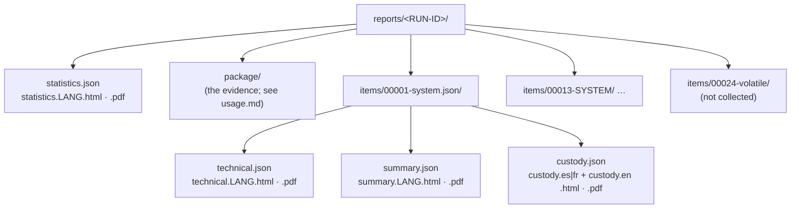
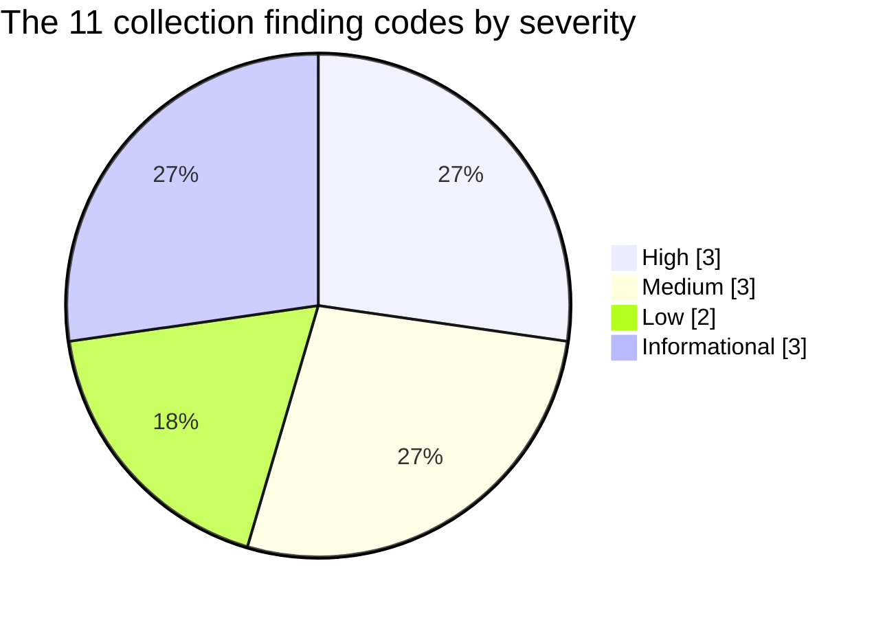

# Reports

Every collection produces one **statistics report** and, for **every packaged file and every target that was not
collected**, two separate reviews — a detailed **technical review** for examiners and lawyers and a short
**customer summary** — plus a **chain-of-custody form**. Each exists as JSON (machine-readable, language-neutral)
and as HTML and PDF in each selected language (`--lang en|es|fr|all`).

**Numbering.** Items are numbered in package order: `volatile/system.json` first, then the volatile files, then the
copied files sorted by group (`evtx`, `hives`, `prefetch`, `browsers`, `tasks`) and path; the targets that were not
collected come last. A not-collected item has size 0, no digest, and its path is the source path (or `volatile`).
The item's *detected type* is its group. Only packaged files are in `hashes.csv`.

**Brand.** HTML and PDF reports carry the Rakvor header band on a light, printable page. With `--sign-cert` each
report shows the signer's certificate subject and SHA-256 fingerprint and each PDF carries a digital signature
([forensic-audit.md](forensic-audit.md#signed-pdf-reports)). The statistics report shows the trusted timestamp or
a warning that it is pending.

**What the reports do not contain.** The package metadata of each copy — read method, `$STANDARD_INFORMATION` and
`$FILE_NAME` times before and after, MFT record, sparse/compressed/encrypted flags, `truncated_at` — is in
`package/manifest.json` and in the `artifact_collected` audit entry, not in the item reports. The item's
*modified* time is the source's `$STANDARD_INFORMATION` modification time (`before.si_modified`), not the time of
the copy.

## What each report contains

| Section | Statistics | Technical review | Customer summary |
| --- | :-: | :-: | :-: |
| Run ID, case, examiner, start/end, duration, interface | ✔ | ✔ (run ID, case) | case, date |
| Hash algorithms, totals, throughput | ✔ | | |
| Findings by severity and by code, items by group | ✔ | | |
| Package path, size, source modified time, group | | ✔ | file name |
| All digests (from the re-read of the packaged copy) | | ✔ | primary only ("digital fingerprint") |
| Findings with **what it shows / what it does not prove** | | ✔ | plain sentence |
| Audit entries covering the item | | ✔ (`#first – #last`) | |
| Limitations | ✔ | ✔ | |
| Status and next step | | ✔ | ✔ |
| Audit chain head, entry count, timestamp | ✔ | | |

## Status and severity

Findings are **signals about how each copy was made**, never verdicts about the machine.

| Severity | Codes | Item status | Exit code |
| --- | --- | --- | --- |
| High | `PARTIAL_READ`, `COPY_REREAD_MISMATCH`, `OUTPUT_ON_SYSTEM_VOLUME`, `UNREADABLE` | `problem` | 3 |
| Medium | `NOT_COLLECTED_LOCKED`, `NOT_COLLECTED_ERROR`, `CHANGED_DURING_COPY` | `attention` | 0 |
| Low | `NOT_COLLECTED_NO_ADMIN`, `VOLATILE_PARTIAL` | `attention` | 0 |
| Informational | `COLLECTED_RAW`, `COLLECTED_API`, `CAPTURED_SNAPSHOT`, `NOT_AVAILABLE_FROM_SOURCE` | `ok` | 0 |

`OUTPUT_ON_SYSTEM_VOLUME` is attached to `volatile/system.json` (the run-level record), so that item is `problem`.

## Findings catalogue

Wording from [i18n/en.json](../i18n/en.json) (`findings`; Spanish and French have the same keys, checked by a test).
Codes are defined in `codes` in [collect/mod.rs](../src/core/src/collect/mod.rs).

### Collection findings

| Code | Severity | Raised when (code) | What it shows | What it does **not** prove |
| --- | --- | --- | --- | --- |
| `COLLECTED_RAW` | info | the file was read from the raw NTFS volume (`copy.rs`) | The file was copied into the package by reading the NTFS volume directly, so files Windows keeps locked could be read. | That the file is complete on disk: data still in the Windows cache and not yet written is not included. |
| `COLLECTED_API` | info | the file was read with the file API | The file was copied into the package through the normal Windows file interface. | That the copy includes data other programs had not yet written, nor the file's NTFS metadata (`$FILE_NAME` times). |
| `CAPTURED_SNAPSHOT` | info | every file the tool writes from the running system: `volatile/*.json` and `volatile/system.json` | The tool wrote the file from what the running system reported; it is not a copy of a file on the volume. | That the system reported everything: protected processes and kernel-level malware can hide entries. |
| `NOT_COLLECTED_NO_ADMIN` | low | live source, not elevated, open/list failed with access denied (5), sharing violation (32) or lock violation (33) | The file was not collected because the tool did not run as administrator (with the OS error). | That the artifact is missing or was hidden; run again elevated to collect it. |
| `NOT_COLLECTED_LOCKED` | medium | sharing or lock violation (32, 33) otherwise (elevated, after the raw read and the API fallback both failed) | The file was locked and could not be read raw (with the error). | That the file is missing or protected on purpose; Windows locks these files in normal use. |
| `NOT_COLLECTED_ERROR` | medium | any other open, list or write error: compressed / encrypted / reparse data on an image, a path that cannot be recreated safely, a full output drive | The file was not collected (with the error). | That the artifact was tampered with; permissions, a full output drive or a damaged disk can cause this. |
| `CHANGED_DURING_COPY` | medium | size, `$SI` modified, `$SI` MFT-changed time or MFT record differ between the stat before and after, or the bytes read ≠ the size before | The source changed during the copy (fields, size before, bytes read); the package holds the bytes read at that moment. | Tampering: event logs and browser history are written to continuously on a running system. |
| `PARTIAL_READ` | high | a read error part-way through the file | Reading stopped at byte *offset* of *size*; the package keeps the bytes read before the error (`truncated_at`). | That the rest of the file was deleted; a damaged sector or a file in use can cause it. |
| `COPY_REREAD_MISMATCH` | high | the re-read of the packaged copy gives another digest or size than the bytes read from the source (`run.rs`) | The packaged copy, read back, differs from what was read (algorithm, both digests). | Which side is wrong; the output drive may be faulty. Collect again to another drive. |
| `VOLATILE_PARTIAL` | low | a volatile list is incomplete (access denied for protected processes, a table that could not be read, cancellation) | *n* of *m* entries of a list are incomplete, with the reason. | That those entries were hidden on purpose; protected processes refuse access even to administrators. |
| `OUTPUT_ON_SYSTEM_VOLUME` | high | live source, `--allow-same-volume`, output on the system volume | The package was written on the system volume of the machine being collected, by explicit choice. | That evidence was overwritten, but writing there can overwrite deleted data; record why it was necessary. |
| `NOT_AVAILABLE_FROM_SOURCE` | info | `volatile` selected with an image or folder source | Volatile data exists only on a running system; this run read an image or folder. | Anything about the system the image or folder came from. |

### Findings from the shared pipeline

| Code | Severity | In a collection? | What it shows | What it does **not** prove |
| --- | --- | --- | --- | --- |
| `UNREADABLE` | high | yes: a packaged file that cannot be re-read | Reading failed (with the error). | That the file is damaged; permissions or locks can cause this. |
| `DUPLICATE` | info | no (duplicate detection is off for collections: identical empty logs are normal) | Identical content appears in several files. | Who copied the file or when. |
| `EMPTY_FILE`, `EXTENSION_MISMATCH`, `EXECUTABLE_CONTENT` | info, medium, high | no (`analyzer.rs` is not called for packaged files) | Template file analysis. | See [i18n/en.json](../i18n/en.json). |
| `EVIDENCE_HASH_MISMATCH_WITH_CASE`, `EVIDENCE_NOT_IN_CASE_REGISTRY`, `REGISTRY_PATH_CONTENT_CHANGED` | high, medium, medium | no (`collect` takes no case folder in v0.1) | Case-folder checks of analysis tools. | See [case-folder.md](case-folder.md). |

## Limitations

Printed in every statistics and technical report, in this order (`LIMITATIONS` in
[report/mod.rs](../src/core/src/report/mod.rs), wording in `limitations` of [i18n/en.json](../i18n/en.json)):

| Code | Says |
| --- | --- |
| `EXECUTION_LEAVES_TRACES` | Running any program on the machine leaves traces of its own (prefetch, Amcache, the USB device entries in the registry): they are expected and must not be read as suspect activity. |
| `RAW_READ_COMMITTED_STATE` | A raw NTFS read sees what is written on disk at that moment; data still in the Windows cache, and files changing during the copy, may differ from what a later image shows. |
| `NO_MEMORY_IMAGE` | This version does not image RAM: the volatile lists are what Windows reported, which malware with kernel access can hide from. |
| `TIMESTAMPS_FROM_FILESYSTEM` | "Modification times come from the file system of the examined copy and may differ from the original source." For a collection the time shown is in fact the **source** file's `$STANDARD_INFORMATION` modification time, which programs can set; the wording is to be aligned. |
| `CLEAN_RESULT_IS_NOT_AUTHENTICITY` | A result without findings does not prove that a file is authentic or unaltered before acquisition. |
| `TIMESTAMP_PROVES_EXISTENCE_ONLY` | A trusted timestamp proves the audit log existed in this exact form at the stated time; it does not prove that the examined copy matches the original source. |

## The package manifest

`package/manifest.json` (`format: rakvor.triage-manifest/1`, no JSON Schema file yet) holds `source` (as in
`source_opened`), `algorithms`, `collected[]` (`package_path`, `group`, `source`, `method`, `bytes`, `hashes`,
`before`, `after`, `truncated_at`, `findings` codes) and `not_collected[]` (`group`, `source`, `reason`, `finding`).
`manifest.csv` has one row per packaged file:
`package_path,group,source,method,bytes,<algo1>[,<algo2>],truncated_at,findings` (finding codes space-separated).
Both are written after the copies and recorded with `output_written`; they do not list themselves.

## JSON schemas

| File | `schema` value | Schema |
| --- | --- | --- |
| `statistics.json` | `rakvor.statistics/1` | [schemas/statistics.schema.json](../schemas/statistics.schema.json) |
| `technical.json` | `rakvor.item-technical/1` | [schemas/item-technical.schema.json](../schemas/item-technical.schema.json) |
| `summary.json` | `rakvor.item-summary/1` | [schemas/item-summary.schema.json](../schemas/item-summary.schema.json) |
| `custody.json` | `rakvor.item-custody/1` | [schemas/item-custody.schema.json](../schemas/item-custody.schema.json) |

Adding a field is a minor change; removing or renaming one bumps the `/N` version. `tests/validate_reports.py`
validates a run in CI.

## PDF notes

PDFs are generated by a small built-in writer (A4, Helvetica/Courier, WinAnsi encoding), so no external program is
needed. WinAnsi covers English, Spanish and French; other scripts would need an embedded font. Every report file's
digest is recorded in the audit log (`item_reports_written`, `statistics_report_written`), so a report altered after
the run is detected by `verify-log`.
