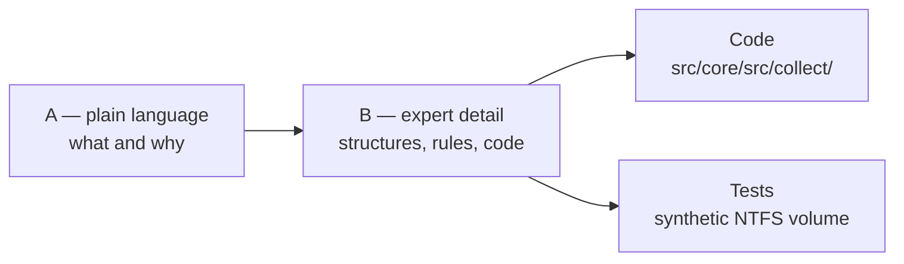
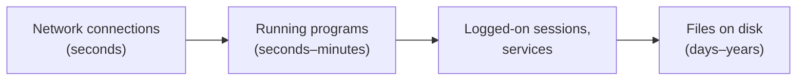
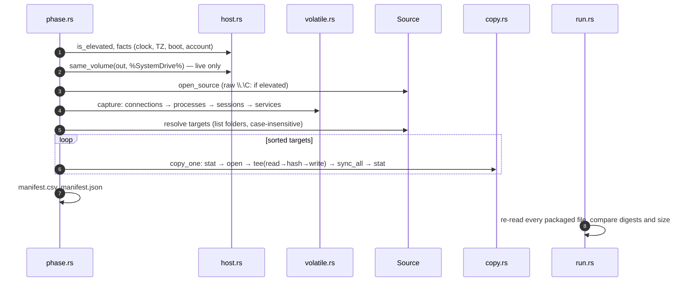
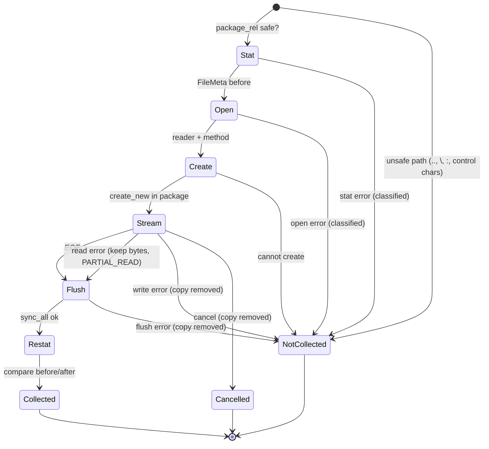

# Theory of operation

How RV Triage collects evidence from a running Windows machine, and why each step is done the way it is.
**Part A** is for clients, lawyers and judges: no maths, no code. **Part B** is for examiners and opposing experts:
data structures, offsets and rules, each taken from the code and linked to it. Where this page and the code
disagree, the code is right and this page is a bug.



## Contents

- [Part A — For clients, lawyers and judges](#part-a--for-clients-lawyers-and-judges)
  - [A1 What the tool is (and is not)](#a1-what-the-tool-is-and-is-not)
  - [A2 Order of volatility: the fast things first](#a2-order-of-volatility-the-fast-things-first)
  - [A3 Why read the disk "raw"](#a3-why-read-the-disk-raw)
  - [A4 Fingerprints, and reading the copy again](#a4-fingerprints-and-reading-the-copy-again)
  - [A5 The tool's own traces](#a5-the-tools-own-traces)
  - [A6 The tool's diary and its timestamp](#a6-the-tools-diary-and-its-timestamp)
  - [A7 What "no findings" means](#a7-what-no-findings-means)
- [Part B — For examiners and opposing experts](#part-b--for-examiners-and-opposing-experts)
  - [B1 Source map](#b1-source-map)
  - [B2 Pipeline and states](#b2-pipeline-and-states)
  - [B3 Volume access: boot sector, MBR and aligned reads](#b3-volume-access-boot-sector-mbr-and-aligned-reads)
  - [B4 Files on NTFS: MFT records, names and lookups](#b4-files-on-ntfs-mft-records-names-and-lookups)
  - [B5 Timestamps: $STANDARD_INFORMATION versus $FILE_NAME](#b5-timestamps-standard_information-versus-file_name)
  - [B6 Reading the data: valid data length and sparse runs](#b6-reading-the-data-valid-data-length-and-sparse-runs)
  - [B7 What is refused, and why](#b7-what-is-refused-and-why)
  - [B8 The copy: one read, two stats, one re-read](#b8-the-copy-one-read-two-stats-one-re-read)
  - [B9 Registry hives and their transaction logs](#b9-registry-hives-and-their-transaction-logs)
  - [B10 Browser history: SQLite WAL and journal files](#b10-browser-history-sqlite-wal-and-journal-files)
  - [B11 Volatile capture](#b11-volatile-capture)
  - [B12 Audit chain and timestamp](#b12-audit-chain-and-timestamp)
  - [B13 References](#b13-references)

# Part A — For clients, lawyers and judges

## A1 What the tool is (and is not)

RV Triage is a collection program run from a USB stick on a computer that is **switched on**. In a few minutes it
copies the records that matter most in an incident — the list of running programs and network connections, the
Windows registry, the event logs, the record of programs started (prefetch), web browser history and scheduled
tasks — into a sealed folder (the *package*) on the stick, together with a diary of everything it did.

It is **not** a disk image (it copies selected files, not the whole disk), **not** a memory image (it records what
Windows reports about running programs, not the memory itself) and **not** an analysis: its findings only describe
how each copy was made. The interpretation is the examiner's job, in the lab.

## A2 Order of volatility: the fast things first

Some information disappears in seconds (a network connection closes, a program exits); some lasts years (a file on
disk). The established guidance for collecting evidence, RFC 3227 (2002), says to collect from the most volatile to
the least volatile. RV Triage follows that rule: it first writes down the network connections, then the running
programs, the logged-on users and the services, and only then copies files from the disk.



## A3 Why read the disk "raw"

While Windows runs, it keeps some of its most important files — the registry and the event logs — **locked**:
ordinary programs, including the copy command, are refused. When RV Triage runs with administrator rights it does
not ask Windows for the file; it reads the disk's own table of contents (NTFS) and the disk sectors directly,
without changing them, like reading a book's pages instead of asking the librarian for it. This is how locked files
are collected. Without administrator rights it uses the normal way, and every file Windows refuses is listed in the
reports with the reason — nothing is silently skipped.

## A4 Fingerprints, and reading the copy again

For every file the tool computes a **digital fingerprint** (a hash such as SHA-256) of the exact bytes it read:
change one byte and the fingerprint changes completely. It does this *while* copying, so the fingerprint describes
what was read from the machine. After all files are copied, it reads every copy **again** from the USB stick and
compares the fingerprints. If a USB stick silently stored a wrong byte, this second reading catches it
(`COPY_REREAD_MISMATCH`). It also looks at each file just before and just after copying it: if Windows changed the
file in between — normal for an event log being written — the report says so (`CHANGED_DURING_COPY`).

## A5 The tool's own traces

Running any program on a computer leaves marks, and RV Triage is no exception. Expect, at the time of the run:

| Trace | Where | Why |
| --- | --- | --- |
| A prefetch file `RV-TRIAGE.EXE-xxxxxxxx.pf` (and `RV-TRIAGE-GUI.EXE-…`) | `C:\Windows\Prefetch` | Windows records every program started |
| Amcache / ShimCache entries for the program on the USB stick | registry, `Amcache.hve` | Windows records executables it ran |
| USB device entries (`USBSTOR`, mounted devices, `setupapi.dev.log`) | registry, `C:\Windows\INF` | the stick was plugged in |
| Logon and elevation events (e.g. the administrator prompt) | Security / System event logs | the examiner logged on and elevated |
| Last-access times of files read through the normal file API, if the machine updates them | NTFS metadata | without administrator rights, files are opened normally; executables are opened to fingerprint them |

These are expected and must not be read as suspicious activity: every report says so (limitation
`EXECUTION_LEAVES_TRACES`). The audit log gives the exact start time of the run so they can be told apart from the
user's activity. What the tool never does: write files on the machine's disk (the output must be on another drive,
or the user must explicitly accept the risk), change the registry, install a driver or service, or change a file
it reads.

## A6 The tool's diary and its timestamp

Every step is written to a diary (the audit log) in which each line contains a fingerprint of the line before. Any
later edit, deletion or reordering breaks the chain and is detected by `rv-triage verify-log`, which also re-checks
the fingerprint of every file in the package. When the machine can reach the internet, an independent
time-stamping authority signs the diary's last fingerprint: proof that the diary existed in that form at that time.

## A7 What "no findings" means

A collection without warnings means each file was copied completely, did not change while copied, and the copy on
the stick matches what was read. It does **not** mean the machine is clean, that the files are authentic, or that
nothing was hidden: malware with deep access can lie to the programs that ask Windows for information
(`NO_MEMORY_IMAGE`), and a file modified before the collection looks like any other file.

# Part B — For examiners and opposing experts

## B1 Source map

| Process | Code | Tests |
| --- | --- | --- |
| Data model, finding codes, error classification | [collect/mod.rs](../src/core/src/collect/mod.rs) | `classification`, `groups_parse` |
| Phase orchestration, manifests, audit entries | [collect/phase.rs](../src/core/src/collect/phase.rs) | `collection_packages_rereads_and_verifies` (run.rs) |
| Aligned device reads, partition window | [collect/ntfs/aligned.rs](../src/core/src/collect/ntfs/aligned.rs) | `raw_device_path_reads_with_aligned_io_only` |
| NTFS lookups, metadata, data streams | [collect/ntfs/volume.rs](../src/core/src/collect/ntfs/volume.rs) | [collect/ntfs/tests.rs](../src/core/src/collect/ntfs/tests.rs) on a synthetic volume |
| Image / live sources | [collect/ntfs_source.rs](../src/core/src/collect/ntfs_source.rs) | `mbr_disk_images_use_the_first_ntfs_partition`, `live_source_without_admin_uses_the_file_api` |
| Targets per group | [collect/targets.rs](../src/core/src/collect/targets.rs) | `resolves_every_group_case_insensitively`, `targets_resolve_on_the_image` |
| Copy, partial reads, change detection | [collect/copy.rs](../src/core/src/collect/copy.rs) | `copies_hashes_and_mirrors_the_path`, `a_read_error_keeps_the_bytes_read_and_flags_partial` |
| Volatile capture | [collect/volatile.rs](../src/core/src/collect/volatile.rs), [collect/host.rs](../src/core/src/collect/host.rs) | `live_capture_without_admin` (Windows), `not_available_elsewhere` |
| Re-read and reports | [run.rs](../src/core/src/run.rs) | `collection_packages_rereads_and_verifies` |

## B2 Pipeline and states



One file's copy, as a state machine (`copy_one`):



## B3 Volume access: boot sector, MBR and aligned reads

**Live.** `\\.\C:` (the drive is `%SystemDrive%`) is opened with `File::open` — read access only; Windows lets
other processes keep reading and writing. A volume handle accepts only reads whose offset and length are multiples
of the sector size. `AlignedReader` serves any byte range from a cache of whole blocks (64 KiB) aligned on 4096
bytes until the boot sector is read, then on the volume's own `bytes_per_sector` (accepted: a power of two from 256
to 4096); reads stop at `total_sectors × bytes_per_sector`.

```text
NTFS boot sector (offsets used by ntfs_source.rs)
  0x03  8 bytes   OEM id "NTFS    "                    → is_ntfs_boot
  0x0B  u16 LE    bytes per sector (e.g. 512 / 4096)    → set_geometry
  0x28  u64 LE    total sectors                         → read limit
  0x1FE 2 bytes   55 AA
```

**Image.** A file whose sector 0 is an NTFS boot sector is a volume image. Otherwise sector 0 must end with `55 AA`
(an MBR); a partition of type `0xEE` means GPT and is refused; the first entry of type `0x07` whose first sector is
an NTFS boot sector is used (`OffsetReader` gives a window onto it). Sectors of 512 bytes are assumed in the MBR.

```text
MBR (sector 0)            partition entry i at 446 + 16·i (16 bytes)
  446..509  4 entries       +4   type: 0x07 NTFS/exFAT, 0xEE GPT protective
  510..511  55 AA           +8   u32 LE first LBA      → offset = LBA × 512
                            +12  u32 LE sector count   → length = count × 512
```

`source_opened` records `layout` (`volume`/`mbr`), `partition_offset`, and the volume geometry and identity:
`bytes_per_sector`, `cluster_size`, `file_record_size`, `volume_serial` (low 32 bits as `ABCD-1234`, as `vol`
prints it), `volume_serial_64`, `total_size`, `ntfs_version`, `volume_label`.

## B4 Files on NTFS: MFT records, names and lookups

Every file is a record in the Master File Table (MFT), numbered from 0; records 0–23 are reserved for metafiles
(`$MFT`, `$LogFile`, `$Volume`, …), record 5 is the root folder. `FileMeta.mft_record` is that number. Each record
also has a **sequence number**, incremented when the record is reused for another file. The reader stores (record,
sequence) when it opens a file and re-resolves the record on every read: if the sequence changed — the file was
deleted and the record reused while it was being copied — the read fails (`MFT record N was reused while it was
being read`) and the copy is `PARTIAL_READ`, never a silent mix of two files.

```text
FILE record header (on disk, before fix-ups)
  0x00  "FILE"
  0x04  u16  offset of the update sequence array (USA)
  0x06  u16  USA count (1 + number of 512-byte strides)
  0x10  u16  sequence number
  ...
  every 512-byte stride ends with the update sequence number; the real two bytes are in the USA
```

Paths are resolved through the `$I30` directory indexes, comparing names case-insensitively with the volume's
`$UpCase` table (so `Ü`/`ü` fold as Windows folds them, not by ASCII rules). DOS 8.3 aliases are skipped in
listings; at the root, names starting with `$` in records below 24 are hidden (metafiles) while `$Recycle.Bin` is
not. A **reparse point** (junction, symbolic link, cloud placeholder) is never traversed and is listed as a file;
the synthetic test volume contains the junction `Users/ana/AppData/Local/Application Data` to prove it
(`junctions_are_files_and_never_followed`).

## B5 Timestamps: $STANDARD_INFORMATION versus $FILE_NAME

NTFS keeps two sets of four times (created, modified, MFT record changed, accessed):

| Attribute | Updated by | Set by user programs? | In the package |
| --- | --- | --- | --- |
| `$STANDARD_INFORMATION` (`si_*`) | most file operations; what Explorer shows | yes (`SetFileTime`): "timestomping" changes these | `before`/`after` in `manifest.json` and `artifact_collected`, raw and API sources |
| `$FILE_NAME` (`fn_*`) | the file system, mainly on create, rename, move | not through the normal API | raw sources only (live elevated, image); the long-name (`Win32`) entry is used, not the 8.3 alias |

Times are FILETIME values (100 ns intervals since 1601-01-01 UTC), converted as
`unix_seconds = ⌊t / 10 000 000⌋ − 11 644 473 600` and written as RFC 3339 UTC with the full **100 ns**
resolution (`2026-01-03T03:04:05.1234567Z`, `collect::fs_time`), so a write within the same second still shows
as `CHANGED_DURING_COPY`. The directory source writes the times the file API returns in the same format. A difference between `si_created` and `fn_created`, or `si_*`
earlier than `fn_*`, is a classic indicator of manipulated times — for the examiner to assess, not a finding of
this tool. The access time is **not** compared before/after the copy (reading may update it).

## B6 Reading the data: valid data length and sparse runs

`open` streams the unnamed `$DATA` stream (alternate data streams are out of scope in v0.1). Small files are
*resident* (the bytes are inside the MFT record); larger ones are *non-resident*: a list of runs (start cluster,
length) on the volume.

```text
Non-resident attribute header (offsets read by volume.rs initialized_size)
  0x10  u64  starting VCN           must be 0 (first extent), else the size below is not trusted
  0x28  u64  allocated size
  0x30  u64  data size              must equal the size reported by the parser
  0x38  u64  initialized size       = valid data length (VDL)
```

**Valid data length.** A file can be extended without writing the new bytes (`SetEndOfFile`); clusters past the
VDL may still hold **stale data from deleted files**. Windows returns zeros past the VDL, and so does RV Triage:
the parser does not expose the field, so `initialized_size` reads it from the attribute header on disk, applying
the update-sequence fix-up when the field crosses a stride end; if anything does not match (extension record, not
the first extent, data size differs) it falls back to the full size, as the parser does. The synthetic volume
tests this: `frag-a.bin` is 20 KiB with 8 KiB written over clusters that held `0xEE` bytes of a deleted file;
the copy is 8 KiB of data followed by 12 KiB of zeros, never `0xEE`.

**Sparse runs.** A run without clusters is a hole and reads as zeros (the test `NTUSER.DAT` is 64 KiB: `regf-ana`,
zeros, `tail`). `FileMeta.sparse` records the flag. The package holds the logical file, holes expanded.

## B7 What is refused, and why

| Data | Raw read (image; live elevated) | Why |
| --- | --- | --- |
| NTFS-compressed (LZNT1) `$DATA`, attribute or file flag | refused, `ErrorKind::Unsupported` | the parser cannot decompress it; serving the compressed clusters as file content would be wrong bytes |
| EFS-encrypted | refused | the bytes on disk are ciphertext; the key is not available |
| Reparse point (link, placeholder, WOF "system-compressed" file) | refused; folders never traversed | the data is elsewhere or transformed; following links could leave the volume or loop |
| Directory | not a file | — |

On an **image** these files become `NOT_COLLECTED_ERROR` with the reason (`… NTFS-compressed (LZNT1) data (raw NTFS
read not supported)`). On a **live elevated** run, `LiveRaw` falls back to the file API **for that file**: Windows
decompresses and decrypts what the account may read, and the method is `api` in the manifest. A panic of the parser
on inconsistent metadata (a live volume changes under the reader) is caught and becomes an `InvalidData` error for
that call.

## B8 The copy: one read, two stats, one re-read

```text
before = stat(source)                      size, mft_record, si_*, fn_*, flags
reader = open(source)                      raw or api
loop:  n = read(chunk)  → write(package) → hash_1, hash_2 (same bytes, one pass)
       read error at offset k → keep k bytes, truncated_at = k, PARTIAL_READ (high)
       write error → delete the copy, NOT_COLLECTED_ERROR
flush + sync_all(package file)
after  = stat(source)
changed = {size, si_modified, si_mft_changed, mft_record} where before ≠ after
          ∪ {size} if no read error and bytes_read ≠ before.size
changed ≠ ∅ → CHANGED_DURING_COPY (medium)
...
after all copies: re-read(package file) → digests' ≠ digests or bytes' ≠ bytes → COPY_REREAD_MISMATCH (high)
```

The digests are those of the bytes **as read from the source**, before they reach the package, so the re-read
checks the write path (USB controller, file system of the stick). Package paths mirror the volume path
(`artifacts/<group>/<volume path>`); a component `.`, `..`, or containing `\`, `:` or a control character is not
recreated (`NOT_COLLECTED_ERROR`). Files are created with `create_new`: nothing in the package is overwritten.

Error classification (`not_collected_finding`): Windows errors 32 (sharing violation) and 33 (lock violation) are
*locked*, 5 or `PermissionDenied` *denied*. On a live source without elevation, locked or denied →
`NOT_COLLECTED_NO_ADMIN` (low); otherwise locked → `NOT_COLLECTED_LOCKED` (medium); anything else →
`NOT_COLLECTED_ERROR` (medium). When raw and API both fail on a live elevated run, the API error is reported when
it carries an OS code, else both messages.

## B9 Registry hives and their transaction logs

| Group `hives` | Volume paths |
| --- | --- |
| System | `Windows/System32/config/{SYSTEM,SOFTWARE,SAM,SECURITY,DEFAULT}` |
| Per profile (`Users/*` except `All Users`, `Default User`; `--users` filters) | `NTUSER.DAT`; `AppData/Local/Microsoft/Windows/UsrClass.dat` |
| With each | `<hive>.LOG1`, `<hive>.LOG2` when present |

Since Windows 8.1, changes to a hive are first written to its transaction logs and flushed into the primary file
later. A primary hive copied without its logs can therefore lack recent changes, or look "dirty" (its sequence
numbers differ). RV Triage copies the logs next to the hive, unmodified, and **does not replay them**: replaying is
an analysis step (registry tools do it in the lab). `Default` and `Public` profile folders are collected like any
other profile.

## B10 Browser history: SQLite WAL and journal files

| Browser | Per profile folder | Files |
| --- | --- | --- |
| Edge | `AppData/Local/Microsoft/Edge/User Data/<profile>/` | `History`, `History-journal`, `History-wal` |
| Chrome | `AppData/Local/Google/Chrome/User Data/<profile>/` | same |
| Firefox | `AppData/Roaming/Mozilla/Firefox/Profiles/<profile>/` | `places.sqlite`, `places.sqlite-wal`, `places.sqlite-journal` |

`<profile>` is every sub-folder of `User Data` / `Profiles` that holds the file. In WAL mode SQLite appends
committed transactions to `-wal` and copies them into the main file at a checkpoint; recent visits may exist only
in the WAL. A rollback `-journal` holds the old content of pages being changed. The tool copies the siblings with
the database, without merging or checkpointing (the SQLite library is never opened on the machine). A browser that
is running writes to these files: `CHANGED_DURING_COPY` is expected.

The other groups: `evtx` = `Windows/System32/winevt/Logs/*.evtx`; `prefetch` = `Windows/Prefetch/*.pf`; `tasks` =
every file under `Windows/System32/Tasks` (sub-folders up to 16 levels). Missing files are simply absent; a folder
that exists but cannot be listed is reported (`artifact_not_collected`, "folder not listed").

## B11 Volatile capture

Captured only for a live source, in this order, and written as pretty JSON with sorted keys, integers and strings
only (no floats), so the Rust and Python verifiers agree:

| File | Windows API | Fields |
| --- | --- | --- |
| `connections.json` | `GetExtendedTcpTable` / `GetExtendedUdpTable`, IPv4 and IPv6, owner pid | protocol, local/remote address and port, TCP state, pid |
| `processes.json` | `CreateToolhelp32Snapshot`; per process: token user, image path, start time, command line (`NtQueryInformationProcess`, `ProcessCommandLineInformation`) | pid, ppid, name, exe_path, command_line, start_utc, user, exe_sha256 (file API, read-only, files over 512 MiB not hashed), note |
| `sessions.json` | `WTSEnumerateSessionsW`, `WTSQuerySessionInformationW` | session id, state, user, station, client name, logon time |
| `services.json` | `EnumServicesStatusExW` + service configuration | name, display name, state, start type, binary path, account, pid |

`volatile_captured` records the start and end time of the capture and the counts. A list that is incomplete gets
`VOLATILE_PARTIAL` with `incomplete` of `of` entries and the reason (e.g. `access denied (error 5)` for protected
processes, grouped by kind); a list that failed entirely has `of = 0`; a cancel marks the remaining lists
`cancelled`. The capture only reads: no files, registry keys, ETW or WMI sessions, drivers or services are created.
These lists are what the Windows APIs report; a rootkit can hide entries from them (`NO_MEMORY_IMAGE`).

`system.json` is written first, before the volatile lists: host name, OS name and build, boot time, time zone,
local and UTC clock at that moment, the account running the tool, elevation, system drive, the source description
and the options. Comparing its clock with a reference clock gives the machine's offset.

## B12 Audit chain and timestamp

Each audit entry stores `entry_hash = SHA-256(canonical JSON without entry_hash)` and the previous entry's hash;
the first entry chains to 64 zeros. The head is sent to an RFC 3161 TSA before the statistics report is written.
`verify-log` re-checks the chain, the token, and re-hashes every file recorded with `output_written`, which
includes every packaged file and both manifests. Details, truncation rules and the list of actions:
[forensic-audit.md](forensic-audit.md).

## B13 References

| Reference | Used for |
| --- | --- |
| RFC 3227, *Guidelines for Evidence Collection and Archiving* (BCP 55, 2002), §2.1 order of volatility, §2.2 things to avoid, §5 tools | A2, A5 |
| ISO/IEC 27037:2012, identification, collection, acquisition and preservation of digital evidence | [admissibility.md](admissibility.md) |
| RFC 3161 (time-stamp protocol), RFC 5652 (CMS) | B12 |
| `ntfs` crate 0.4 (Colin Finck), MIT OR Apache-2.0 — the NTFS parser | B4–B7 |
| Brian Carrier, *File System Forensic Analysis* (2005), NTFS chapters — MFT, attributes, times (general reference, to be verified page by page) | B4–B6 |
| SQLite documentation: "Write-Ahead Logging", "Atomic Commit" (rollback journal) | B10 |
| Microsoft documentation: `GetExtendedTcpTable`, `CreateToolhelp32Snapshot`, `WTSEnumerateSessionsW`, `EnumServicesStatusExW`, `SetFileValidData` / valid data length | B6, B11 |
