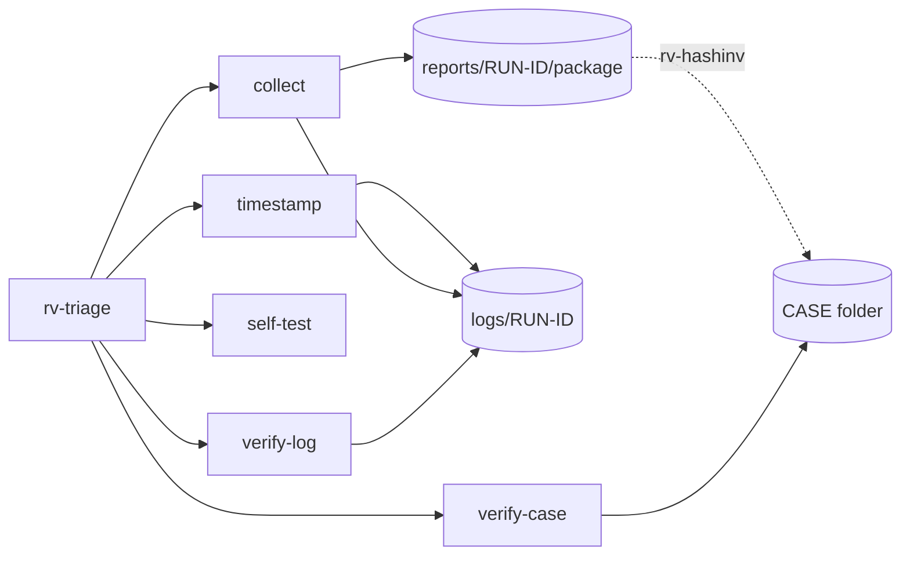

# Command-line reference

<!-- Generated by `rv-triage docs-cli`. Do not edit by hand: CI fails if this file differs. -->



## rv-triage

```text
DESCRIPTION:
  rv-triage runs from a USB stick on a live Windows 10/11 machine and collects, into one package:
    1. preflight: checks elevation and that the output folder is not on the system volume of the
       machine being collected; records the host (name, OS, time, system drive);
    2. volatile data first, because it changes fastest: processes, network connections, logon
       sessions and services (volatile/*.json);
    3. files of each group: registry hives (system and per user), event logs, prefetch, browser
       history (Edge, Chrome, Firefox) and scheduled tasks. Each file is read once: the bytes are
       hashed with one or two algorithms while they are written to the package, and the file is
       stat'ed before and after (CHANGED_DURING_COPY if it moved);
    4. writes manifest.csv and manifest.json, then re-reads every packaged file and compares it
       with the digests taken during the copy (COPY_REREAD_MISMATCH);
    5. writes the statistics report, one technical report, summary and custody form per packaged
       file, and a hash-chained audit log that `rv-triage verify-log` checks later.
  A file that cannot be read (locked, no administrator rights, error) is listed as not collected,
  with the reason; the run continues. The examiner then registers the package in the lab with
  rv-hashinv (case folder, evidence ids).

Usage: rv-triage <COMMAND>

Commands:
  collect       Collect volatile data and Windows artifacts into a hashed, audit-logged package
  verify-log    Verify an audit log (audit.jsonl): edited, deleted or re-ordered entries, and
                truncation
  self-test     Check every hash algorithm against known-answer test vectors
  timestamp     Add an RFC 3161 timestamp to a finished run (e.g. after working offline)
  verify-case   Verify a whole case folder: case log, evidence registry and every run's audit log
  update-check  Check whether a newer release of this tool is published (notify only: nothing is
                downloaded)
  help          Print this message or the help of the given subcommand(s)

Options:
  -h, --help
          Print help (see a summary with '-h')

  -V, --version
          Print version

Run `rv-triage <COMMAND> --help` for the options, examples and exit codes of each command.
```

## rv-triage collect

```text
DESCRIPTION:
  rv-triage runs from a USB stick on a live Windows 10/11 machine and collects, into one package:
    1. preflight: checks elevation and that the output folder is not on the system volume of the
       machine being collected; records the host (name, OS, time, system drive);
    2. volatile data first, because it changes fastest: processes, network connections, logon
       sessions and services (volatile/*.json);
    3. files of each group: registry hives (system and per user), event logs, prefetch, browser
       history (Edge, Chrome, Firefox) and scheduled tasks. Each file is read once: the bytes are
       hashed with one or two algorithms while they are written to the package, and the file is
       stat'ed before and after (CHANGED_DURING_COPY if it moved);
    4. writes manifest.csv and manifest.json, then re-reads every packaged file and compares it
       with the digests taken during the copy (COPY_REREAD_MISMATCH);
    5. writes the statistics report, one technical report, summary and custody form per packaged
       file, and a hash-chained audit log that `rv-triage verify-log` checks later.
  A file that cannot be read (locked, no administrator rights, error) is listed as not collected,
  with the reason; the run continues. The examiner then registers the package in the lab with
  rv-hashinv (case folder, evidence ids).

Usage: rv-triage collect [OPTIONS]

Options:
  -o, --out <DIR>
          Folder where logs/ and reports/ (with the package) are created. Created if missing.
          Required: choose the USB or network drive; the system volume of the machine being
          collected is refused unless --allow-same-volume.
          Default: none (required)
          Example: --out E:\triage

  -s, --source <SRC>
          What to collect from: live (the running Windows system), a raw NTFS volume image
          file (.dd, .img, .raw) or a folder laid out like a volume root (a mounted image, a
          test set). Volatile data exists only for live.
          Default: live
          Example: --source D:\images\laptop-c.dd   or   --source examples\sample\source

  -g, --groups <LIST>
          Artifact groups, comma-separated: volatile, evtx, hives, prefetch, browsers, tasks,
          or all.
          Default: all
          Example: --groups volatile,evtx,hives

  -u, --users <NAMES>
          Only these user profiles (folder names under Users\), comma-separated or repeated.
          Applies to the per-user hives and the browser history.
          Default: every profile
          Example: --users ana.ruiz,ben.test

      --allow-same-volume
          Accept an output folder on the system volume of the machine being collected (live
          source). Writing there can overwrite deleted data: the run gets the high finding
          OUTPUT_ON_SYSTEM_VOLUME (exit code 3).
          Default: off (refused, exit code 1)
          Example: --allow-same-volume

  -H, --hash <ALGO>
          Hash algorithm(s): one or two of md5, sha1, sha256, sha512, sha3-256, blake3.
          Both are computed in the same read of each file. More than two is refused (exit 2).
          Default: sha256
          Example: --hash sha256,md5   or   --hash sha256 --hash blake3

  -l, --lang <LANG>
          Report language: en, es, fr, or all (one HTML and PDF per language). JSON is
          language-neutral.
          Default: en
          Example: --lang es   or   --lang all

  -a, --actor <NAME>
          Name of the examiner, written in every audit entry and report.
          Default: the operating-system user name
          Example: --actor "Ana Ruiz"

  -c, --case <ID>
          Case or engagement identifier printed on the reports.
          Default: none
          Example: --case CASE-2026-014

  -p, --progress <MODE>
          How progress is shown: bar, jsonl or none.
          Default: bar (hidden automatically when stderr is not a terminal)
          Example: --progress jsonl

          Possible values:
          - bar:   Progress bar with elapsed time, files or bytes done and ETA on stderr
          - jsonl: One JSON event per line on stdout (for scripts and other tools)
          - none:  No progress output; only the final summary

  -j, --jurisdiction <CC>
          Chain-of-custody form per item: co (Colombia, Fiscalía style, Spanish) or fr (France,
          scellés, French). An English copy is always added.
          Default: co
          Example: --jurisdiction fr

      --tsa-url <URL>
          RFC 3161 time-stamping authority for the audit chain head.
          Default: http://timestamp.digicert.com
          Example: --tsa-url https://freetsa.org/tsr

      --no-timestamp
          Do not request a trusted timestamp (offline). Also set by RV_NO_TIMESTAMP=1.
          Default: off (a timestamp is requested)
          Example: --no-timestamp

      --sign-cert <P12>
          Examiner's certificate (.p12/.pfx, RSA) used to sign every PDF report. The password
          is read from the environment variable named by --sign-pass-env, or asked for
          interactively.
          Default: none (PDFs are not signed)
          Example: --sign-cert E:\certs\ana-ruiz.p12

      --sign-pass-env <VAR>
          Environment variable holding the certificate password.
          Default: RV_SIGN_PASSWORD
          Example: --sign-pass-env CERT_PASS

  -h, --help
          Print help (see a summary with '-h')

EXAMPLES:
  Collect everything from the running system onto the USB drive E: (run as administrator):
    rv-triage collect --out E:\triage --case CASE-2026-014 --actor "Ana Ruiz"
  Only event logs and registry hives, SHA-256 + MD5, Spanish reports, one user profile:
    rv-triage collect -o E:\triage --groups evtx,hives --users ana.ruiz --hash sha256,md5 --lang es
  Rehearse on a mounted image or a test folder, reports in three languages, JSON events:
    rv-triage collect -s D:\mounted-c -o E:\triage --lang all --progress jsonl > events.jsonl
  Verify the audit log and every packaged file afterwards:
    rv-triage verify-log E:\triage\logs\<RUN-ID>
  In the lab, register the package in the case folder:
    rv-hashinv scan -i E:\triage\reports\<RUN-ID>\package -r --case-dir F:\CASE-014

EXIT CODES:
  0    Completed; no high-severity finding (files not collected for lack of rights or locks
       are medium or low findings, listed in the reports).
  1    Runtime error (--source not found or not readable, output not writable, output on the
       system volume without --allow-same-volume). See the audit log when one was created.
  2    Usage error (--out missing, unknown option or group, more than two hash algorithms,
       unsupported language).
  3    Completed with at least one high-severity finding: a file read only in part
       (PARTIAL_READ), a packaged copy that differs from what was read (COPY_REREAD_MISMATCH),
       or the package written on the system volume (OUTPUT_ON_SYSTEM_VOLUME).
  130  Cancelled with Ctrl+C. Partial package, reports and the cancellation are in the audit log.

FILES WRITTEN:
  <OUT>/reports/<RUN-ID>/package/         The package to hand over to the lab:
    volatile/system.json                  Collection host, source, options, elevation.
    volatile/<NAME>.json                  Processes, connections, sessions, services (live only).
    artifacts/<GROUP>/<PATH ON VOLUME>    Each copied file at its path on the volume, e.g.
                                          artifacts/hives/Windows/System32/config/SAM.
    manifest.csv                          One row per packaged file: path, group, source,
                                          method (raw|api|snapshot), bytes, digests, findings.
    manifest.json                         The same, plus every file not collected and why.
  <OUT>/logs/<RUN-ID>/audit.jsonl         Hash-chained log of every action (JSON Lines).
  <OUT>/logs/<RUN-ID>/audit.log           The same actions, human-readable.
  <OUT>/logs/<RUN-ID>/hashes.csv          Hash register of the packaged files (re-read).
  <OUT>/logs/<RUN-ID>/environment.json    Tool and dependency versions, OS, host, user, command.
  <OUT>/logs/<RUN-ID>/timestamp-<SEQ>.tsr|.json  RFC 3161 token for the audit chain head.
  <OUT>/reports/<RUN-ID>/statistics.json  Run statistics (+ statistics.<LANG>.html and .pdf).
  <OUT>/reports/<RUN-ID>/items/<NNNNN>-<NAME>/technical|summary.json|.<LANG>.html|.<LANG>.pdf
  <OUT>/reports/<RUN-ID>/items/<NNNNN>-<NAME>/custody.json|.<es|fr>.html|.pdf|.en.html|.pdf

FORENSIC NOTES:
  - Run from removable media (USB or network drive) and write the package there: --out on the
    system volume of the machine being collected is refused (it can overwrite deleted data)
    unless --allow-same-volume, which adds the high finding OUTPUT_ON_SYSTEM_VOLUME.
  - Elevated (Run as administrator): files are read from the raw NTFS volume, so locked hives
    and event logs are collected (method raw). Not elevated: the normal file API is used; locked
    files and other users' profiles are listed as NOT_COLLECTED_NO_ADMIN and the run continues.
  - Running the tool leaves its own traces on the machine: a prefetch file for rv-triage.exe,
    Amcache / ShimCache entries, USB device entries (USBSTOR, setupapi.dev.log) and event log
    records. Note the time of the run so they can be told apart from the user's activity.
  - No RAM image is taken: volatile/*.json is what the Windows APIs report, not a memory dump.
    Capture memory with a dedicated tool first if it matters.
  - Every packaged file is hashed while it is read and re-read from the package afterwards; the
    source is opened read-only. A finding says how a copy was made, never what it means.
  - Each audit entry stores the SHA-256 of the previous one; editing, deleting or re-ordering any
    line is detected by `verify-log`, which also re-hashes every packaged file. Removing the
    last lines is detected only against the RFC 3161 timestamp: keep the log with the package.
  - MD5 and SHA-1 are accepted for compatibility; pair them with SHA-256 or BLAKE3.
  - Offline? The run finishes with `timestamp_pending`; run `rv-triage timestamp <LOG>` later.
  - With --sign-cert every PDF is signed with the examiner's certificate; the password is never
    logged.
```

## rv-triage verify-log

```text
Verify an audit log (audit.jsonl): edited, deleted or re-ordered entries, and truncation

Usage: rv-triage verify-log [OPTIONS] <LOG>

Arguments:
  <LOG>
          Path to audit.jsonl, or to the run's log folder that contains it.
          
          Example: rakvor-out/logs/20261019T101500Z-a1b2c3

Options:
      --tsa-ca <PEM>
          CA bundle (PEM with one or more certificates, or one DER certificate) that the TSA
          certificate of every timestamp token must chain to, at the token's genTime.
          
          Default: none (the TSA signature is checked, the chain is not).
          Example: --tsa-ca C:\certs\tsa-roots.pem

  -h, --help
          Print help (see a summary with '-h')

CHECKS:
  - every entry links to the previous one (hash chain): an edited, deleted or re-ordered entry
    breaks it;
  - every timestamp token the log records (timestamp_obtained) is still next to it with its
    metadata (timestamp-<SEQ>.tsr with the recorded SHA-256, timestamp-<SEQ>.json agreeing): a
    missing file is a problem, never a skipped check; a token file no entry records is checked
    too. Every token covers the hash of the entry it names;
  - the TSA's CMS signature of every token: signer certificate in the token, ESS
    signing-certificate binding, message digest over TSTInfo, RSA signature, and an extended key
    usage that is critical and only timeStamping (RFC 3161). With --tsa-ca, also the TSA
    certificate path up to that CA bundle at the token's genTime (every candidate issuer tried;
    CA flag, keyCertSign, pathLenConstraint, directoryName name constraints, no unsupported
    critical extension); without it the output says "chain not checked". Revocation is
    never checked: establish it from CRL/OCSP evidence covering genTime;
  - truncation: a chain alone cannot show that entries were removed from its end. The log must
    still contain the entry covered by its RFC 3161 timestamp (covers_seq) and, for a run inside
    a case folder (<CASE>/runs/<TOOL>/<RUN-ID>/logs), end with the audit head that the case log
    recorded at run_finished (only timestamp_obtained may follow). Entries after the last
    anchored one are listed as not provable; with neither record the output says
    "truncation not detectable without a timestamp or case record";
  - recorded outputs: every file the log says the run wrote (package files and manifests,
    item reports, statistics, hashes.csv, environment.json) is re-hashed with each algorithm
    recorded and compared; the
    latest entry for a file wins. A missing, edited or replaced file is a problem; a recorded
    path that is absolute, contains .. or resolves outside the run folder (symlink, junction)
    is rejected and not read. Timestamp tokens (checked above) and files written outside the
    run folder are listed as not re-hashed, with the reason. Output: "outputs: N verified of
    M recorded (algorithms)".

EXAMPLES:
  rv-triage verify-log rakvor-out/logs/20261019T101500Z-a1b2c3/audit.jsonl
  rv-triage verify-log rakvor-out/logs/20261019T101500Z-a1b2c3
  rv-triage verify-log E:\CASE-014\runs\rv-triage\20261019T101500Z-a1b2c3\logs
  rv-triage verify-log rakvor-out/logs/20261019T101500Z-a1b2c3 --tsa-ca digicert-tsa-roots.pem

EXIT CODES:
  0  The chain is intact and agrees with its timestamps and case record (if any), and every
     output file it records (package, reports, hashes.csv, environment.json) still has the
     recorded digests.
  1  The log or the --tsa-ca file cannot be read.
  3  The chain is broken (an entry was edited, deleted or re-ordered), a timestamp does not
     match or does not verify (altered token, invalid TSA signature, chain not trusted by
     --tsa-ca), the log is shorter than its timestamp or case record says (truncated), or
     a recorded output file was edited, deleted or replaced after the run (named in the
     output; a recorded path that leads outside the run folder is rejected, not read).
```

## rv-triage self-test

```text
Check every hash algorithm against known-answer test vectors

Usage: rv-triage self-test

Options:
  -h, --help
          Print help (see a summary with '-h')

EXAMPLES:
  rv-triage self-test

EXIT CODES:
  0  All algorithms give the published answer for the input "abc".
  1  At least one algorithm failed: do not use this build for evidence.
```

## rv-triage timestamp

```text
Add an RFC 3161 timestamp to a finished run (e.g. after working offline)

Usage: rv-triage timestamp [OPTIONS] <LOG>

Arguments:
  <LOG>
          The run's log folder (or its audit.jsonl).
          
          Example: rakvor-out/logs/20261019T101500Z-a1b2c3

Options:
      --tsa-url <URL>
          RFC 3161 time-stamping authority.
          Default: http://timestamp.digicert.com
          Example: --tsa-url https://freetsa.org/tsr

  -a, --actor <NAME>
          Name written in the new audit entry.
          Default: the operating-system user name
          Example: --actor "Ana Ruiz"

  -h, --help
          Print help (see a summary with '-h')

EXAMPLES:
  rv-triage timestamp rakvor-out/logs/20261019T101500Z-a1b2c3
  rv-triage timestamp rakvor-out/logs/20261019T101500Z-a1b2c3 --tsa-url https://freetsa.org/tsr

EXIT CODES:
  0  Timestamp obtained and logged.
  1  The TSA could not be reached (nothing changed; try again).
  3  The log is missing or broken: no timestamp is added.
```

## rv-triage verify-case

```text
Verify a whole case folder: case log, evidence registry and every run's audit log

Usage: rv-triage verify-case [OPTIONS] <CASE>

Arguments:
  <CASE>
          The case folder (the one that holds case.json).
          
          Example: E:\CASE-014

Options:
      --rehash
          Also re-hash every registered item still reachable and compare it with the registry.
          Default: off (only the registry's digest is checked)
          Example: --rehash

  -h, --help
          Print help (see a summary with '-h')

CHECKS:
  - case-log.jsonl is an intact hash chain starting with case_created; case.json is unchanged;
  - evidence/registry.json has the SHA-256 recorded at the last registry change;
  - every run announced in the case log has an intact audit.jsonl (and valid timestamp
    tokens: imprint and TSA signature; the TSA chain is not checked, use verify-log
    --tsa-ca), its case_linked entry points to its run_started entry, and the audit head
    recorded at run_finished is its final entry (only timestamp_obtained may follow);
  - every output file a run's audit log records (reports, hashes.csv, environment.json) is
    re-hashed and compared with the recorded digests (edited, deleted or replaced: a problem);
  - with --rehash: every registered item still reachable at its registered path is read again
    and its digests are compared with the registry (the latest registration of a path).

EXAMPLES:
  rv-triage verify-case E:\CASE-014
  rv-triage verify-case E:\CASE-014 --rehash

EXIT CODES:
  0  The case folder is intact (warnings, e.g. a run still in progress or an item not
     reachable for --rehash, are printed).
  1  The folder is not a case folder (no case.json).
  3  At least one check failed: the case was edited, truncated or re-ordered, a run's
     recorded output (report, register) was edited, deleted or replaced, or (--rehash) an
     evidence file differs from the registry.
```

## rv-triage update-check

```text
Check whether a newer release of this tool is published (notify only: nothing is downloaded)

Usage: rv-triage update-check [OPTIONS]

Options:
      --json
          Print one JSON object (schema rakvor.update-check/1) instead of one line.
          Default: off
          Example: --json

  -h, --help
          Print help (see a summary with '-h')

SENDS:
  One HTTPS GET of https://github.com/Panacota96/rv-triage/releases/latest (the redirect to the
  latest release is read, not followed), with the header User-Agent: rv-triage/<version>, and
  nothing else: no case, evidence, examiner or machine data. Nothing is downloaded or installed.
  No other command contacts the network for this; the desktop app checks once at start-up.

OFF SWITCH:
  RV_NO_UPDATE_CHECK=1 (any value but empty or 0), or the file update-check-off in
  %APPDATA%\Rakvor (RV Hub's setting), turns the check off for every Rakvor tool.

EXAMPLES:
  rv-triage update-check
  rv-triage update-check --json

EXIT CODES:
  0  This is the latest release, or the check is turned off.
  1  The check could not be made (offline, timeout, no published release): nothing changed.
  3  A newer release is published: the output names it and its release page.
```

## rv-triage describe

```text
Describe this tool as JSON (schema rakvor.describe/1) for RV Hub and scripts

Usage: rv-triage describe [OPTIONS]

Options:
      --json
          Print JSON: one pretty-printed object with sorted keys.
          Default: on (JSON is the only format)
          Example: --json

  -h, --help
          Print help (see a summary with '-h')

DESCRIPTION:
  Prints what this tool is, what it accepts and how to launch it, validated by
  schemas/describe.schema.json. RV Hub reads it to list the tool and start it.
  Fields: schema, tool, title, version, role (collection: it reads a live system, an image
  or a folder, and its package is registered later with rv-hashinv), main_verb (collect),
  accepts (empty: no evidence file is an input), case_formats, log_formats, cli_exe,
  gui_exe, exit_codes. Nothing is read or written; no audit log is created.

EXAMPLES:
  rv-triage describe --json

EXIT CODES:
  0  The description was printed.
```

