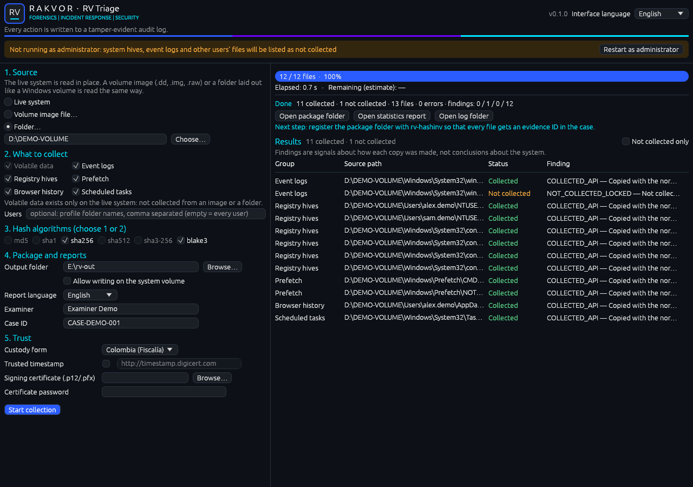
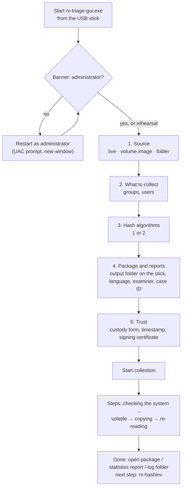

# Using the desktop app (Windows 10/11)

`rv-triage-gui.exe` is the collection screen: the same engine as `rv-triage collect`, the same package, logs and
reports. Run it from the USB stick, next to `rv-triage.exe`.

*The screenshot is rendered headless by `cargo run -p rv-triage-gui --example triage_screenshot -- docs/images/gui-main.png`:
a synthetic folder source (`alex.demo`, `sam.demo` are made-up profiles), not elevated, SHA-256 + BLAKE3; one event
log was held open without sharing during the run, hence the `NOT_COLLECTED_LOCKED` row.*

## Workflow

## The window

| Area | What it does |
| --- | --- |
| Header | Interface language (English, Español, Français; switchable at any time), version, the note that every action is audited |
| Elevation banner | Green *Administrator: locked files are read directly from the NTFS volume*, or amber *Not running as administrator: system hives, event logs and other users' files will be listed as not collected* with **Restart as administrator** (settings chosen in this window are not carried over) |
| 1. Source | **Live system** (default), **Volume image file…** or **Folder…** with a path field and *Choose…*; a folder or image dropped on the window becomes the source |
| 2. What to collect | Volatile data, event logs, registry hives, prefetch, browser history, scheduled tasks (all ticked by default). Volatile data is greyed out for an image or folder. **Users**: profile folder names, comma-separated (empty = every user) |
| 3. Hash algorithms | Tick 1 or 2 (default sha256); a third is refused with a tooltip |
| 4. Package and reports | **Output folder** (required; "a removable or examiner drive"), **Allow writing on the system volume** (with the amber warning), report language (or all three), examiner (default: OS user), case ID |
| 5. Trust | Custody form (Colombia / France), trusted timestamp on/off and TSA URL, signing certificate (`.p12`/`.pfx`) and its password |
| Start collection / Cancel | Start is disabled until an output folder is set, an image/folder path is given when that source is chosen, and at least one group is selected; the reason is shown. Cancel finishes the current file, then writes the partial package and reports |
| Progress | Files done / total during the copy, then bytes during the re-read; elapsed time and an estimate; the current step |
| Done panel | Counts (collected, not collected, files, errors, findings high/medium/low/info), **Open package folder**, **Open statistics report**, **Open log folder**, and the hint to register the package with rv-hashinv |
| Results | One row per artifact: group, source path, status (Collected / Not collected), the most severe finding with its title; **Not collected only** filter. "Findings are signals about how each copy was made, not conclusions about the system." |

## What the GUI records

Every setting changed before a run is kept with its time (`at_utc`) and written at the start of that run's audit
log, before `environment_recorded`; then `ui_start_clicked` records the full configuration. Code:
[src/gui/src/state.rs](../src/gui/src/state.rs).

| Action | Details |
| --- | --- |
| `ui_source_changed` | `kind` (live, image, folder), `path` |
| `ui_groups_changed`, `ui_users_changed` | the groups; the user list |
| `ui_hash_selection_changed` | the algorithms |
| `ui_output_folder_changed`, `ui_allow_system_volume_changed` | the path; `allowed` |
| `ui_language_changed`, `ui_interface_language_changed` | report language; interface language |
| `ui_examiner_changed`, `ui_case_id_changed` | the new values |
| `ui_jurisdiction_changed`, `ui_timestamp_changed`, `ui_signing_certificate_changed` | the trust settings (never the password) |
| `ui_result_filter_changed` | the *Not collected only* filter (recorded in the next run) |
| `ui_restart_as_admin_clicked`, `ui_restart_as_admin_failed` | elevation request; the error when the UAC prompt was declined (the window stays open) |
| `ui_restarted_as_admin` | in the new elevated window: `requested_at_utc` (passed as `--elevation-requested-at`), `elevated` |
| `ui_launch_argument_ignored` | a launch argument that was not used: `--case-dir` (a collection writes a package), a second source, `--case-dir` without a folder |
| `ui_start_clicked` | algorithms, lang, source kind and path, groups, users, allow_same_volume, elevated, out_dir, jurisdiction, timestamp, pdf_signing |

The recorded actions belong to the next run that starts; they are cleared when it starts.

## Launch arguments

| Argument | Effect |
| --- | --- |
| a folder or image path (or a drop on the `.exe` icon) | becomes the source (folder → *Folder*, file → *Volume image file*); only the first one is used |
| `--case-dir <CASE>` | ignored and recorded (RV Hub passes it to every tool; register the package with rv-hashinv instead) |
| `--elevation-requested-at=<UTC>` | set by *Restart as administrator* for the new window |

## Same results as the command line

The GUI builds the same `RunConfig` as `rv-triage collect` (`frontend: gui` in `run_started`), runs the engine on a
worker thread and shows its events. Package, digests, findings and reports are the same; only the `ui_*` entries
and the frontend name differ.
