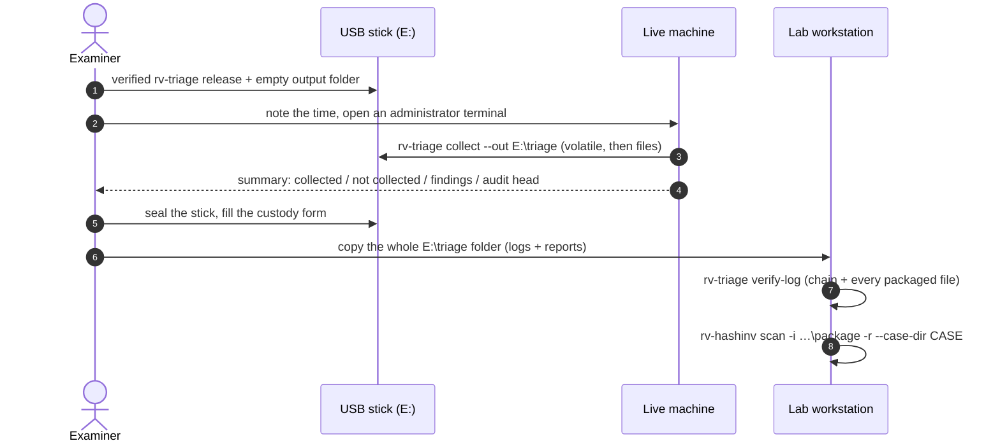
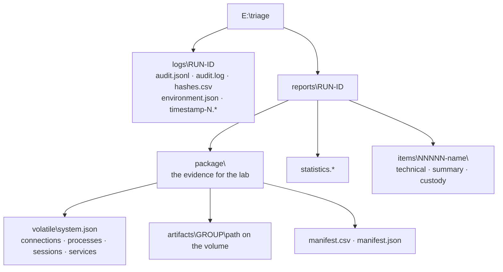

# Usage guide: from a live machine to a registered package

This page walks through one collection end to end: preparing the USB stick, collecting on the machine, reading
every output, verifying the package and handing it to rv-hashinv in the lab. Every option is in
[usage-cli.md](usage-cli.md) (generated from `--help`); the desktop app is in [usage-gui.md](usage-gui.md).



## 1. Before you go

| Check | Why |
| --- | --- |
| The release on the stick was verified (`SHA256SUMS`, provenance, signature) and `self-test` passed on your workstation ([installation.md](installation.md)) | You can say which build ran |
| A rehearsal on the sample source gave the expected result ([examples](../examples/README.md)) | Same tool, known answer |
| The stick has room for the package: event logs and hives are typically hundreds of MB, plus about 11 report files per item for one language (19 with `--lang all`) | A full drive gives `NOT_COLLECTED_ERROR` |
| You know whether the machine may reach the network | The only traffic is the timestamp request; use `--no-timestamp` if it must stay offline |
| You can get administrator rights on the machine | Without them, system hives, event logs and other users' files are not collected |
| Memory matters? Capture RAM with a dedicated tool **first** | RV Triage does not image RAM (`NO_MEMORY_IMAGE`) |

## 2. Collect

### 2.1 Command line (recommended)

Insert the stick, note the time on your watch and on the machine's clock, open **Command Prompt or PowerShell as
administrator** (Start → type `powershell` → *Run as administrator*), then run the tool **from the stick**:

```powershell
E:\rv-triage\rv-triage.exe collect --out E:\triage --case CASE-2026-014 --actor "Ana Ruiz"
```

| Option | Use |
| --- | --- |
| `--out DIR` (required) | Folder on the USB or network drive. On the system volume it is refused (exit 1) unless `--allow-same-volume`, which adds the high finding `OUTPUT_ON_SYSTEM_VOLUME` |
| `--groups LIST` | `volatile, evtx, hives, prefetch, browsers, tasks` or `all` (default) |
| `--users NAMES` | Only these profile folders under `Users\` (per-user hives and browser history) |
| `--hash ALGOS` | One or two of md5, sha1, sha256 (default), sha512, sha3-256, blake3; keep `sha256` as one of them |
| `--lang`, `--jurisdiction`, `--case`, `--actor` | Report language(s), custody form (co/fr), case id, examiner name |
| `--no-timestamp`, `--tsa-url` | No network request / another TSA |
| `--sign-cert`, `--sign-pass-env` | Sign every PDF with the examiner's certificate |
| `--progress bar|jsonl|none` | Progress display; `jsonl` prints one JSON event per line on stdout |

What you see while it runs (progress bar mode, stderr; file names and counts are illustrative):

```text
phase: preflight
phase: volatile (4 steps)
phase: copy (412 files)
warning: [evtx] C:\Windows\System32\winevt\Logs\Security.evtx: CHANGED_DURING_COPY
not collected: [hives] C:\Users\ben\NTUSER.DAT (NOT_COLLECTED_LOCKED)
phase: verify (420 packaged files re-read, reports)
```

Only lines the examiner must notice are printed: a file not collected, or a finding above *info*.

The final summary (stdout), here for the sample source of [examples/](../examples/README.md):

```text
DONE  run 20261115T161524Z-d85cae
  source: directory
  collected: 23  not collected: 1  bytes: 10745  errors: 0  elapsed: 0.5 s
  findings: high 0, medium 0, low 0, info 24
  timestamp: off
  package: …\reports\20261115T161524Z-d85cae\package
  report: …\reports\20261115T161524Z-d85cae\statistics.en.html
  logs:   …\logs\20261115T161524Z-d85cae
  audit head: 7b8ae28e5a0bc4ec1e32fc49a0562781f30f42abf5e324751948f2fe29e6d973
  next: in the lab, register the package with rv-hashinv: rv-hashinv scan -i "…\package" -r --case-dir <CASE>
```

On a live machine the `source:` line says `live (elevated: raw NTFS read)` or `live (not elevated: locked files and
other profiles not collected)`. **Write the run id and the audit head in your notes**; the head is what a later
`verify-log` must end on.

### 2.2 Desktop app

Start `rv-triage-gui.exe` from the stick. If the banner says *Not running as administrator*, click
**Restart as administrator** (settings are not carried over). Choose the source (live system by default), the
groups, the output folder on the stick, then **Start collection**. Details and the audited UI actions:
[usage-gui.md](usage-gui.md).

### 2.3 Rehearsal and lab use: image or folder source

`--source` also accepts a raw NTFS volume image (`.dd`, `.img`, `.raw`; an MBR disk image works, GPT does not in
v0.1) or a folder laid out like a volume root (for example a mounted image). No administrator rights are needed
and no volatile data exists (`NOT_AVAILABLE_FROM_SOURCE`):

```powershell
rv-triage collect --source D:\images\laptop-c.dd --out E:\triage --groups evtx,hives
rv-triage collect --source examples\sample\source --out $env:TEMP\rv-rehearsal --no-timestamp
```

## 3. Reading the outputs



| Output | Read it for |
| --- | --- |
| `statistics.<LANG>.html` | Totals, findings by severity and code, the audit head and timestamp. Start here. |
| `package\manifest.csv` | One line per packaged file: where it came from, `raw`/`api`/`snapshot`, bytes, digests, finding codes |
| `package\manifest.json` | The same with before/after metadata, plus **every file not collected and why** |
| `package\volatile\system.json` | Host name, OS build, boot time, time zone, local and UTC clock, account, elevation, source, options |
| `package\volatile\processes.json` | pid, ppid, name, executable path, command line, start time, user, executable SHA-256, `note` when a field was refused |
| `package\volatile\connections.json` | protocol, local/remote address and port, TCP state, owning pid |
| `package\volatile\sessions.json`, `services.json` | logon sessions (state, user, station, client, logon time); services (state, start type, binary path, account, pid) |
| `items\NNNNN-…\technical.<LANG>.html` | Per file: digests from the re-read, findings with what they do not prove, audit entry range |
| `items\NNNNN-…\summary.<LANG>.html`, `custody.*` | Plain-language summary; custody form to print and sign |
| `logs\RUN-ID\hashes.csv` | Hash register of the packaged files (re-read) |

Full field lists: [reports.md](reports.md).

## 4. Interpreting each finding

| Finding | Next check | Do not conclude |
| --- | --- | --- |
| `COLLECTED_RAW` / `COLLECTED_API` | None: how the copy was made | That the file is complete or unaltered before collection |
| `NOT_COLLECTED_NO_ADMIN` | Run again as administrator if the file matters | That the file is missing or hidden |
| `NOT_COLLECTED_LOCKED` | Collect from an image of the disk | That someone protected the file on purpose |
| `NOT_COLLECTED_ERROR` | Read the error: compressed/encrypted data on an image, a full output drive, a damaged disk | Tampering |
| `CHANGED_DURING_COPY` | Expected for active logs and browser history; compare `before`/`after` in `manifest.json` | Tampering |
| `PARTIAL_READ` (high) | Check `truncated_at` and the error; re-collect, or image the disk | That the rest of the file was deleted |
| `COPY_REREAD_MISMATCH` (high) | Suspect the output drive; collect again to another drive | Which side is wrong |
| `VOLATILE_PARTIAL` | Expected for protected processes; read the reason | That entries were hidden on purpose |
| `OUTPUT_ON_SYSTEM_VOLUME` (high) | Record why no other drive was available | That evidence was overwritten |
| `NOT_AVAILABLE_FROM_SOURCE` | None (image or folder source) | Anything about the original system |

The tool's own traces on the machine (prefetch for `rv-triage.exe`, Amcache, USB device entries, logon events) are
expected: [theory.md A5](theory.md#a5-the-tools-own-traces).

## 5. Verify and hand over

Copy the **whole output folder** (`logs\` and `reports\` side by side) to the lab; `verify-log` needs both to
re-hash the package.

```powershell
rv-triage verify-log F:\incoming\triage\logs\20261115T161524Z-d85cae
# OK  152 entries, chain intact: …\audit.jsonl
#     truncation not detectable without a timestamp or case record
#     outputs: 294 verified of 294 recorded (md5, sha256)
python tests\verify_chain.py F:\incoming\triage\logs\20261115T161524Z-d85cae   # independent check
```

`outputs:` covers every packaged file, both manifests, every report, `hashes.csv` and `environment.json`. A file
changed, removed or replaced since the collection makes the run `BROKEN` (exit 3) and is named. The `truncation:`
line says what vouches for the length of the log: with a timestamp, the entries up to the stamped one; without one,
nothing (stamp it now with `rv-triage timestamp <log folder>` and keep the audit head from your notes).

Then register the package in the case folder with **rv-hashinv** (the intake tool), which gives each file an
evidence id:

```powershell
rv-hashinv scan -i F:\incoming\triage\reports\20261115T161524Z-d85cae\package -r --case-dir F:\CASE-014 --case CASE-014
```

Keep the `logs\` and `reports\` folders of the collection with the case file: they are the record of how the
package was made. More: [case-folder.md](case-folder.md).

## 6. Timestamps

Online, every run asks the TSA (`http://timestamp.digicert.com` by default) to sign the audit head; the summary says
`timestamp: ok <genTime>`. Offline it says `pending` and the run still completes. Later, from any connected machine:

```powershell
rv-triage timestamp F:\incoming\triage\logs\20261115T161524Z-d85cae
rv-triage verify-log F:\incoming\triage\logs\20261115T161524Z-d85cae --tsa-ca digicert-tsa-roots.pem
```

A timestamp obtained in the lab proves the log existed then, not at collection time: say so in the report.

## 7. Starting from RV Hub: `--case-dir` and `describe --json`

RV Hub (the Rakvor launcher) lists the installed tools and opens them on a case folder. For RV Triage:

- **`rv-triage-gui.exe --case-dir <CASE>`**: a collection writes a package, not into a case folder, so the
  argument is **ignored**; the window says so and the run's audit log records `ui_launch_argument_ignored`
  ("--case-dir … ignored: a collection writes a package; register it with rv-hashinv"). A folder or image passed
  as an argument (or dropped on the icon) becomes the source; a second one is ignored the same way.
- **`rv-triage describe --json`** prints one JSON object (sorted keys, schema
  [`schemas/describe.schema.json`](../schemas/describe.schema.json), `rakvor.describe/1`); hidden from `--help`
  but listed in [usage-cli.md](usage-cli.md). It reads and writes nothing.

| Field | Value |
| --- | --- |
| `role` | `collection`: reads a live system, an image or a folder; its package is registered later with rv-hashinv |
| `main_verb` | `collect` |
| `accepts` | empty `extensions` and `signatures`: no evidence file is an input |
| `case_formats`, `log_formats` | `rakvor.case/1`; `rakvor.audit/1` |
| `cli_exe`, `gui_exe` | `rv-triage.exe`, `rv-triage-gui.exe` |
| `exit_codes` | 0, 1, 2, 3, 130 (section 8) |

## 8. Troubleshooting

### Exit codes

| Code | Meaning | What to do |
| :-: | --- | --- |
| 0 | Completed, no high finding | Check the not-collected list anyway |
| 1 | `--source` not found or not readable, output not writable, output on the system volume, wrong certificate password | Read the `error:` line; the audit log (if created) ends with `run_failed` |
| 2 | Usage: `--out` missing, unknown group or algorithm, three algorithms, unknown language | Fix the command |
| 3 | Completed with `PARTIAL_READ`, `COPY_REREAD_MISMATCH`, `OUTPUT_ON_SYSTEM_VOLUME` or `UNREADABLE`; `verify-log`: a problem | Read the findings / the `BROKEN` lines |
| 130 | Ctrl+C | Partial package; the manifests list what was copied |

### Messages

| Message | Cause and fix |
| --- | --- |
| `the output folder … is on the system volume …` | `--out` points to the machine's own disk. Use the stick; `--allow-same-volume` only when nothing else is possible |
| `--out is required` | There is deliberately no default output folder |
| `--source X: no such file or folder` | Typo in the image or folder path (checked before anything is written) |
| `GPT disk images are not supported in v0.1` | Extract the NTFS partition into a volume image first |
| Many `NOT_COLLECTED_NO_ADMIN` | The terminal was not elevated: run again as administrator |
| `NOT_COLLECTED_ERROR … NTFS-compressed (LZNT1) data (raw NTFS read not supported)` | Image or folder source only; on a live elevated run the file API is used for that file instead |
| `live collection needs Windows` | `--source live` on Linux/macOS: use an image or folder source |
| `timestamp pending` | No network; run `rv-triage timestamp` later |
