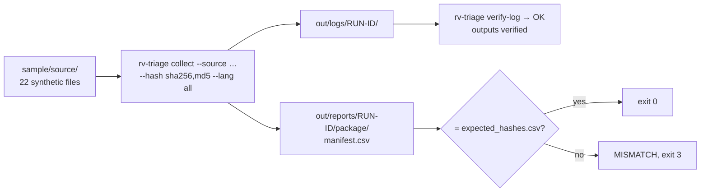

# Examples

## `sample/` — a synthetic Windows volume root for rehearsals

`sample/source/` is a small folder laid out like `C:\`, with one or two files per artifact group. Every file is
placeholder bytes: the right magic number at offset 0 (`regf`, `ElfFile`, `MAM\x04` / `SCCA`, `SQLite format 3`,
UTF-16 task XML) followed by a banner saying it is fake. No file is a parsable artifact and none holds personal
data; the profiles `ana.ruiz` and `ben.test` are invented. `make_source.py` regenerates it byte for byte.

| Group | Files in `source/` | Expected finding |
| --- | --- | --- |
| `hives` | `Windows/System32/config/{SYSTEM,SYSTEM.LOG1,SOFTWARE,SAM,SECURITY,DEFAULT}`; `NTUSER.DAT` and `UsrClass.dat` of both profiles (10 files) | `COLLECTED_API` (info) |
| `evtx` | `Windows/System32/winevt/Logs/{Application,Security,System}.evtx` | `COLLECTED_API` |
| `prefetch` | `CMD.EXE-0BD30981.pf` (compressed form), `NOTEPAD.EXE-D8414F97.pf` (uncompressed form) | `COLLECTED_API` |
| `browsers` | Edge `History` + `History-journal` (ana.ruiz); Chrome `History`, Firefox `places.sqlite` + `places.sqlite-wal` (ben.test) | `COLLECTED_API` |
| `tasks` | `RakvorSampleUpdater`, `RakvorSample/DailyCheck` | `COLLECTED_API` |
| `volatile` | — (a folder has no running system) | `NOT_AVAILABLE_FROM_SOURCE` (info), not collected |

| File | Content |
| --- | --- |
| `expected_hashes.csv` | Package path, size, SHA-256 and MD5 of the 22 artifact files, computed independently with Python's `hashlib` (`make_expected.py`) |
| `expected_findings.json` | The finding codes of every packaged file and of the not-collected volatile group; expected exit code 0 |
| `run.ps1` / `run.sh` | Self-test, collection, `verify-log`, then compare `package/manifest.csv` with `expected_hashes.csv` (exit 3 on any difference) |
| `make_source.py` / `make_expected.py` | Regenerate `source/`, then the expected files ([development.md](../docs/development.md#the-sample-source)) |



Run it:

```bash
examples/sample/run.sh target/release/rv-triage          # Linux / macOS (RV_SAMPLE_OUT changes the output folder)
```

```powershell
.\examples\sample\run.ps1 -Bin .\rv-triage.exe          # Windows
```

Expected summary: `collected: 23  not collected: 1  errors: 0`, findings `high 0, medium 0, low 0, info 24`
(22 artifacts + `volatile/system.json` as `COLLECTED_API`, the volatile group as `NOT_AVAILABLE_FROM_SOURCE`), exit
code 0, then `manifest.csv matches expected_hashes.csv (22 files: size, SHA-256, MD5)`. A folder source is read
with the file API, so the manifest's `method` column is `api` everywhere except `snapshot` for `system.json`.

The raw NTFS path (locked files, `$FILE_NAME` times, sparse and valid-data-length handling) is exercised by the
synthetic volume image `src/core/tests/fixtures/ntfs-windows.img.gz` in the test suite, not by this sample.
